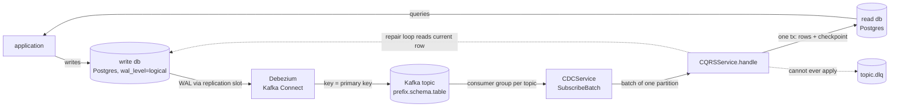
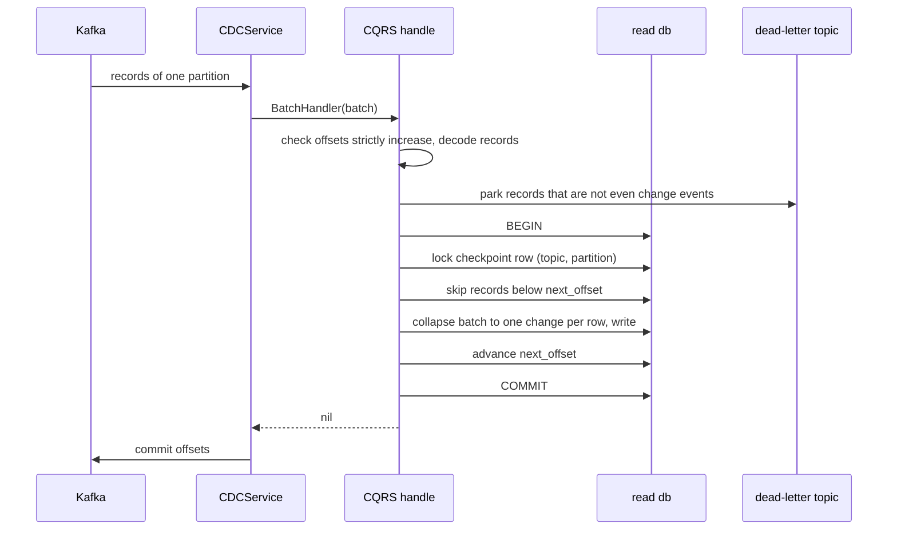
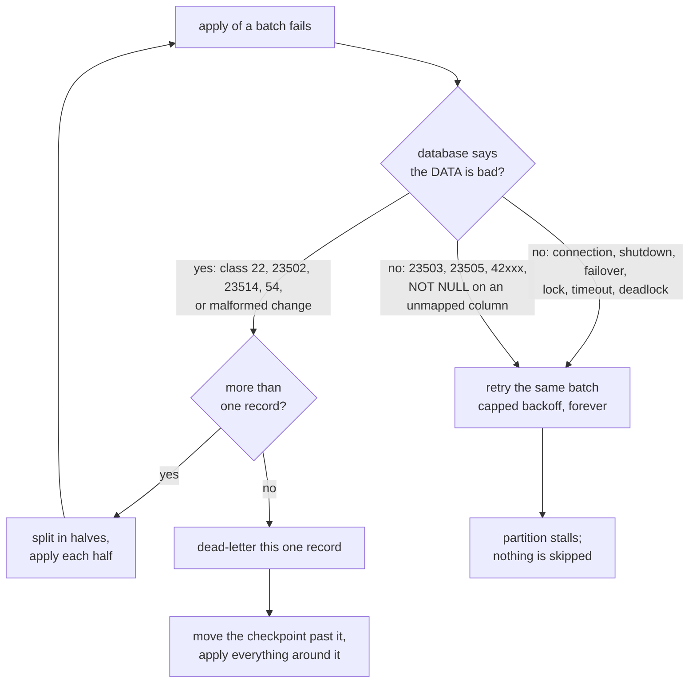
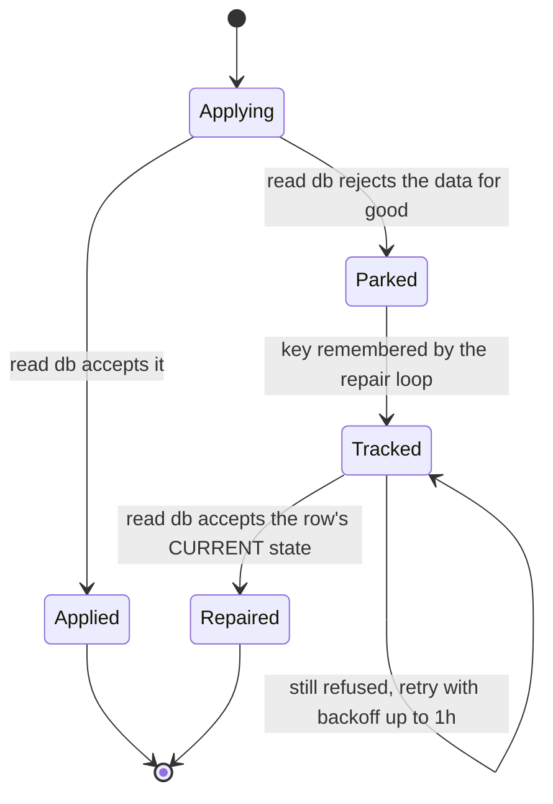
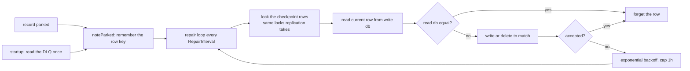

# Kafka, CDC and CQRS architecture

How a write to the **write database** reaches the **read database**, what happens to a change that fails, and why the two databases still end up equal after outages, crashes and bad data.

This is the architecture view. The per-package detail, test inventory and known limits are in [database.md](database.md).

## Contents

1. [The pipeline](#1-the-pipeline)
2. [One batch, step by step](#2-one-batch-step-by-step)
3. [Why the two databases stay equal](#3-why-the-two-databases-stay-equal)
4. [Failure handling](#4-failure-handling)
5. [The dead-letter topic (DLQ)](#5-the-dead-letter-topic-dlq)
6. [Automatic repair of parked rows](#6-automatic-repair-of-parked-rows)
7. [Ordering](#7-ordering)
8. [Startup checks](#8-startup-checks)
9. [Failure matrix: what if X is down](#9-failure-matrix-what-if-x-is-down)
10. [Operating it](#10-operating-it)
11. [Error handling conventions](#11-error-handling-conventions)

---

## 1. The pipeline

| Stage | Package or component | Job |
|---|---|---|
| Write database | Postgres, `wal_level=logical` | Source of truth. All writes go here. |
| Debezium | `docker/debezium/register.sh` | Reads the WAL through a replication slot and publishes one record per row change. Keys each record by primary key, so all changes of a row land on one partition, in order. |
| Kafka | broker | Durable, ordered per partition log of changes. |
| CDC | `internal/pkg/cdc` | Consumes the topic and hands consecutive records of one partition to a handler. At least once, ordered per partition. Commits offsets only after the handler succeeds. |
| CQRS | `internal/pkg/cqrs` | The handler. Applies each batch to the read database exactly once in effect, parks what can never be applied, repairs parked rows. |
| Read database | Postgres | Serves queries. Lags the write database by the replication delay. |

Topic naming: `<CDC_TOPIC_PREFIX>.<schema>.<table>`. Consumer group per topic: `<BROKER_GROUP_ID>.<topic>`, so each table has independent progress. The dead-letter topic is `<topic>.dlq`.

### Debezium settings that the design depends on

| Setting | Why |
|---|---|
| `replica.identity.autoset.values = .*:FULL` | With `REPLICA IDENTITY FULL` an update carries the whole row. Without it Debezium leaves out unchanged TOAST columns and the read model would be handed a placeholder. CQRS refuses to start on a table that is not FULL. |
| `tombstones.on.delete = true` | Debezium follows every delete with a tombstone record so Kafka compaction can drop the key. CDC skips tombstones. |
| `decimal.handling.mode = string` | Money never travels as a float. |
| `topic.creation.default.partitions` | Partition count belongs to Debezium. Batch consumers do not auto-create the topic, so a consumer cannot create it with one partition first and break replica sharing. |
| `slot.name`, `publication.name` | One slot per connector. An unused slot makes Postgres retain WAL, so drop slots of connectors you remove. |

---

## 2. One batch, step by step

1. **Check.** `checkBatch` confirms one topic and partition with strictly increasing offsets. Anything else would corrupt the checkpoint, so the batch is rejected with `ErrBadBatch`.
2. **Park poison first.** Records that cannot be decoded as a change event are published to the dead-letter topic **before** the transaction that moves the checkpoint past them. A record the checkpoint already covers was parked by an earlier delivery and is not parked again.
3. **Transaction on the read database**, bounded by `ApplyTimeout`:
   1. mark the transaction as the replicator (`app.replicator`), so row-level security lets it write every tenant's rows;
   2. lock this partition's row in `cqrs_checkpoints` (`INSERT ... ON CONFLICT DO UPDATE ... RETURNING` takes the lock and returns the stored offset in one statement);
   3. skip records whose offset is below `next_offset` (already applied);
   4. refuse to skip records that are newer than anything applied (`ErrOffsetRegression`, see [section 4](#4-failure-handling));
   5. collapse the rest to the change a one-at-a-time application would leave, and write it;
   6. advance `next_offset` to the last offset plus one.
4. **Return nil only when every record is durably handled** (applied, a duplicate, skipped on purpose, or on the dead-letter topic). Only then does CDC commit the offsets to Kafka.

Once a transaction has begun it is allowed to finish even if the service is asked to stop. It commits whole or rolls back whole, and records it did not finish are delivered again.

---

## 3. Why the two databases stay equal

Kafka delivers at least once, so any record can arrive twice. The system turns that into **exactly once in effect** with one rule: the rows and the position that says "applied up to here" are written in **one transaction** on the read database.

| Situation | Outcome |
|---|---|
| Crash after the read-db commit, before the Kafka commit | Records are redelivered. The checkpoint is already ahead, so nothing is written twice. |
| Crash during the transaction | The transaction rolls back. Rows and position both unchanged, so the batch is simply applied again. |
| Lost connection or failover mid-transaction | Same as a crash. |
| Two replicas briefly handle the same partition (rebalance) | The second waits on the checkpoint lock, then finds the checkpoint ahead and skips what the first did. No coordination service needed. |
| Kafka commit fails | Only means redelivery, which the checkpoint absorbs. A failed commit never stops the stream. |

The reverse never happens: the Kafka offset is committed only **after** the read-database commit, so the stream is never ahead of the data.

---

## 4. Failure handling

The first question for any error is: **is it the data's fault, or the infrastructure's?** The answer decides between retry and dead-letter.

### Retry forever: never skip

| Failure | Behavior |
|---|---|
| Read database down, failover, killed connections, read-only after promotion | Retried with exponential backoff, from `RetryBackoff` up to `MaxRetryBackoff`. The partition stalls, which is the safe direction. |
| Dead-letter topic unreachable | The batch is retried. Nothing is lost. |
| Handler panic | Recovered and turned into an error, then retried. |
| Rejection that is not the data's fault: foreign key (23503), unique (23505), undefined column or table (42xxx) | Retried, **not** dead-lettered. These mean the schema or ordering is wrong, and dead-lettering would empty the stream. A migration or a later change resolves them. |
| `NOT NULL` violation on a column the model does not map | Retried, **not** dead-lettered. The read table is ahead of the code and every row would fail the same way. It waits for the deploy. |

### Park: only what can never succeed

A record is dead-lettered only when the database rejects **the data itself**: SQLSTATE class 22 (bad text encoding, numeric out of range, bad date), 23502 (`NOT NULL`) and 23514 (`CHECK`) on a mapped column, class 54 (beyond a hard limit), or a change that cannot even be written as SQL (`ErrMalformedChange`, for example a NUL byte).

When a batch fails that way, the service **splits it in halves** until the single record at fault is alone, parks that one, moves the checkpoint past it, and applies everything around it. One bad row never stops the stream and never takes good rows with it.

### Pause: topic recreated

If a record behind the checkpoint is **newer** than the last applied record, offsets have restarted (the topic was recreated). Skipping them as "already applied" would silently drop every change, so replication fails with `ErrOffsetRegression` and stays paused and loud.

### Classification in code

`internal/pkg/sql` decides, from the SQLSTATE in the error chain:

| Function | Meaning |
|---|---|
| `IsPermanent(err)` | The database rejected the data. Retrying unchanged can never succeed. |
| `IsTransient(err)` | Says nothing about the data (no SQLSTATE at all, or class 08, 25, 40, 53, 55, 57, 58, XX). Retry unchanged. |
| neither | Wait for another change or a migration. Retried, never dropped. |

Dropping a change is only ever allowed for `IsPermanent`. The CQRS layer adds one exception: `NOT NULL` on an unmapped column is retried.

---

## 5. The dead-letter topic (DLQ)

### What goes in

A record on `<topic>.dlq` keeps the **original key, value and headers**, plus:

| Header | Value |
|---|---|
| `dlq.original-topic` | topic it came from |
| `dlq.original-partition` | partition |
| `dlq.original-offset` | offset |
| `dlq.error` | why it was parked (SQLSTATE and location only) |
| `dlq.attempts` | attempts made |
| `dlq.group` | consumer group |
| `dlq.failed-at` | time, RFC 3339 |

**The error never contains row data.** Postgres messages can quote the offending row, so only the SQLSTATE, table, column and constraint are kept (`Describe`, `safeErr`). A poison record cannot leak customer data into logs or the DLQ.

### Who writes to it

| Path | Rule |
|---|---|
| CQRS batch path (`SubscribeBatch`) | The handler decides what is permanently bad and calls `DeadLetter` once per record, in one attempt bounded by its context. Everything else is retried forever. |
| Single-record path (`Subscribe`) | The handler is tried 3 times with backoff from 200 ms, then the record is parked and the stream moves on. While the DLQ itself is unreachable the publish is retried with a backoff capped at 5 s, and the record stays uncommitted until it succeeds or the service stops. Suits idempotent side effects, not data replication. |

### Reading it back

`DeadLetters(ctx, topic, limit)` returns every parked record in partition and offset order. It asks the brokers for the topic's start and end offsets and stops at the end, so it never waits for a quiet moment. It creates and consumes nothing, so it can be called repeatedly. It fails with `ErrTooManyDeadLetters` rather than truncating a topic larger than `limit` (default 100,000). A topic with no DLQ yet returns no records and no error.

### Life of a parked record

A parked record is never replayed from the DLQ as an event. The DLQ is the **audit trail and the source of keys** for repair; the repair writes the row's current state, not the old event ([section 6](#6-automatic-repair-of-parked-rows)).

---

## 6. Automatic repair of parked rows

A parked change leaves its row at an older state in the read database. Nobody has to remember to fix that: the service does.

- **It writes the write database's current row, never the parked event.** An old event cannot be trusted: a row deleted and recreated since has changed under it. The current row is where the stream is heading anyway, so writing it is always safe, and whatever the stream still has to deliver lands on top, in order.
- **It takes the same checkpoint row locks as replication.** While it works, no replica writes the table, so what it reads from the write database cannot be older than what the read database already holds.
- **It compares exact values** before touching a row, so a row is written only when it really differs.
- **A row that is still refused** is retried with exponential backoff from `RepairInterval` (default 30 s) up to one hour, and never blocks other rows.
- **At startup** the loop reads the dead-letter topic once, so rows parked by an earlier process or another replica are found. Nothing depends on this process having been alive when the change was parked.
- It is started by `Run` and ended by `Stop`. A negative `RepairInterval` turns it off.

`Stats.Awaiting` is how many rows wait for the read database to accept them. `Stats.Repaired` is how many were fixed.

---

## 7. Ordering

Three independent layers decide which change wins when changes arrive late, twice or replayed.

| Layer | What it does | When |
|---|---|---|
| Stream order | Kafka keeps one row's changes in order on one partition. | Always |
| Version guard | `ON CONFLICT ... DO UPDATE ... WHERE t.version IS NULL OR t.version <= EXCLUDED.version`. An older version never overwrites a newer one. | When `ColumnVersion` is set |
| WAL position (`OrderByLSN`) | Each row remembers the Debezium `source.lsn` of its last change in `cqrs_row_state`, **including deletes** (tombstones). A change older than the stored position is turned away. | When `OrderByLSN` is set |

A version counter restarts when a row is deleted and created again, so the version guard alone cannot order generations. The WAL position never goes backwards within one write database, so ordering by it has no such blind spot. Limits (one WAL timeline, tombstone retention above Kafka retention) are in [database.md](database.md#known-limits-read-these).

---

## 8. Startup checks

`Run` calls `verify` first, so a misconfiguration fails at startup instead of on the first change:

| Check | Error |
|---|---|
| Write database answers | `ErrWriteDBUnreachable` |
| Read database answers | `ErrReadDBUnreachable` |
| `cqrs_checkpoints` exists in the read database | `ErrReadTableMissing` (create it with `CheckpointDDL`) |
| `cqrs_row_state` exists, when `OrderByLSN` is on | `ErrReadTableMissing` (create it with `RowStateDDL`) |
| The model's table exists in the read database with every mapped column | `ErrReadTableMissing` |
| The model's table exists in the write database with `REPLICA IDENTITY FULL` | `ErrWriteTableMissing`, `ErrReplicaIdentity` |

`NewCQRS` panics, as a programming error, for a model it cannot replicate: a non-struct, no usable primary key, a composite key, a version column that cannot order, array columns (store as `jsonb`), and `timestamp`, `time` or `interval` columns (use `timestamptz`; the Debezium form of those depends on column precision).

---

## 9. Failure matrix: what if X is down

| Component down | Effect | Data loss | Recovery |
|---|---|---|---|
| Read database | Batches retry with backoff, partition stalls, the write database keeps working | None | Automatic when it returns; backlog drains from Kafka |
| Write database | Application cannot write; replication has nothing new; repair cannot read | None | Automatic. After a **failover to a new WAL timeline**: re-snapshot and `TRUNCATE cqrs_row_state` |
| Kafka | Debezium and consumers wait; the replication slot holds WAL in Postgres | None, but WAL grows | Automatic when Kafka returns. Watch disk used by the slot |
| Debezium / connector task | No new events reach Kafka; the slot holds WAL | None, but WAL grows | Restart the task. **Nothing in the Go code alerts on this**, so monitor the connector |
| Dead-letter topic | Parking fails, so the batch is retried | None | Automatic when it returns |
| This service (crash, deploy) | Offsets uncommitted since the last commit are redelivered | None | Checkpoint skips what was applied |
| One replica of several | Its partitions rebalance to the others | None | Automatic |
| Read database rejects some rows | Those records are parked, the rest flow | None; the row is stale until repaired | Repair loop heals it once the cause is fixed |
| Topic recreated | `ErrOffsetRegression`, replication pauses | None | Operator decision: re-snapshot, then reset the checkpoints |
| Connector started before its table exists | Task stays `FAILED` | None | Create tables first, or restart the task |

Every row says "None" for data loss because the design only ever **retries or parks, never drops**, and parks keep the original record.

---

## 10. Operating it

### Alert on these

| Signal | Meaning |
|---|---|
| `Stats.DeadLettered` rising | Records are being parked. Look at the DLQ headers for the SQLSTATE and column. |
| `Stats.Awaiting` stays above zero | The read schema keeps rejecting rows. It is usually stricter than the write schema; fix the schema. |
| `Stats.Retries` growing, `Stats.LastError` set | A database is unreachable or a schema is behind the code. |
| `Stats.CommitFails` rising | Kafka offset commits fail; safe (redelivery) but a sign of broker trouble. |
| `Stats.HooksDropped` rising | Change hooks are being dropped because too many run at once. Hooks are best effort. |
| Consumer lag | Replication is behind. |
| Debezium connector or task state | A failed task stops all events silently. |
| Replication slot lag and WAL size on the write database | An idle or slow slot retains WAL. |
| DLQ topic size | Growth means a persistent cause. |

### Production conditions

- Kafka replication factor above 1 and `min.insync.replicas` of 2. The development compose file uses 1.
- Postgres backups and monitoring on **both** databases.
- Run `CheckpointDDL` (and `RowStateDDL` with `OrderByLSN`) in the read database's migrations.
- Keep `RowStateRetention` (default 14 days) above Kafka's topic retention.
- Keep the read schema at least as permissive as the write schema. A `CHECK` or `NOT NULL` that exists only on the read side is the usual cause of parks.
- Route reads that must see a just-made write to the write database. The read database lags by the replication delay and does not provide read-your-writes.

### When something is parked

1. Read the DLQ (`DeadLetters`) and look at `dlq.error` for the SQLSTATE, table and column.
2. Fix the cause: relax the read-side constraint, widen the column, or correct the write-side data.
3. Do nothing else. The repair loop writes the row's current state on its next pass, and `Stats.Awaiting` falls to zero.

---

## 11. Error handling conventions

The packages follow the same rules, so errors behave the same everywhere:

- Errors are **wrapped with context** using `%w` (`fmt.Errorf("storing code: %w", err)`), so `errors.Is` and `errors.As` see through every layer. `%v` is used only at a boundary that must hide internals.
- Sentinel errors read `package: lowercase message` with no trailing punctuation, and callers match them with `errors.Is`.
- An error is **returned or logged, never both**. Logging happens at the top of a unit of work; the CQRS service logs through `slog` with stable messages and the variable data as attributes.
- Anything that can quote data goes through `Describe` first: log lines and dead-letter headers carry the SQLSTATE and location, never row values.
- A failed query is an error, never an empty result. `Count` returns the error just as `Exists` does, so "no matches" and "the query failed" can never look the same.
- A panic is reserved for programmer error at construction time. At runtime boundaries (handlers, hooks, the repair pass) it is recovered and turned into an error.
