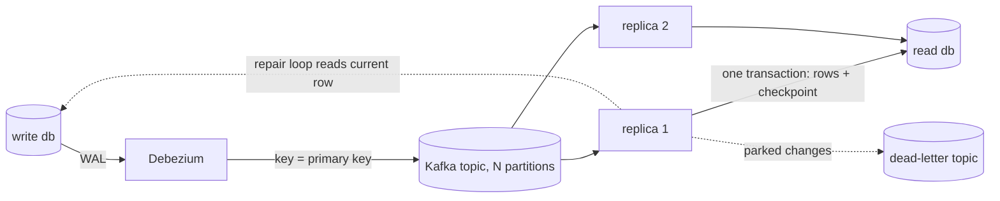
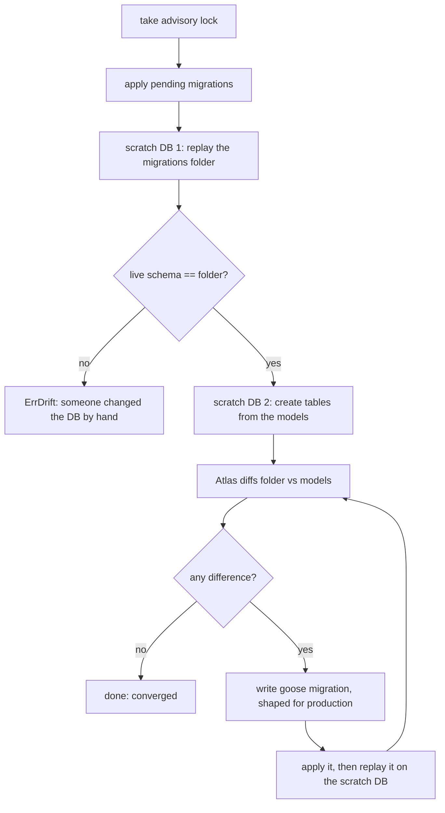

# Database layer: CDC, CQRS, SQL migrations and pagination

This document explains the database-facing packages of ecoop-server: **how they work, why they are built that way, what the tests prove, and where the honest limits are.** Each section ends with a production-readiness verdict, because "the tests pass" is not the same as "safe to run".

For the end-to-end picture of Kafka, Debezium, CDC and CQRS (failure handling, the dead-letter topic, repair, and what happens when each component is down), see [cdc-cqrs-architecture.md](cdc-cqrs-architecture.md).

## Contents

1. [At a glance](#1-at-a-glance)
2. [The five design rules](#2-the-five-design-rules)
3. [CDC: reading change events from Kafka](#3-cdc-reading-change-events-from-kafka)
4. [CQRS: keeping the read database equal to the write database](#4-cqrs-keeping-the-read-database-equal-to-the-write-database)
5. [SQL service and migrations](#5-sql-service-and-migrations)
6. [Pagination and filters](#6-pagination-and-filters)
7. [What "ready for production" means, and the conditions](#7-what-ready-for-production-means-and-the-conditions)
8. [Running the tests](#8-running-the-tests)
9. [What the tests found](#9-what-the-tests-found)

Verdict labels used throughout:

- **Proven**: a test fails if the property is broken, and the test runs against a real Postgres (and Kafka and Debezium where relevant), not a mock.
- **Designed, partly proven**: the behavior is deliberate and tested in the common cases, but a documented edge is not covered.
- **Not covered**: the code does not try to do this. Handle it operationally.

---

## 1. At a glance

| Package | Job | Tests (top-level / passing incl. subtests) | Verdict |
|---|---|---|---|
| CDC `internal/pkg/cdc` | Deliver Debezium change events from Kafka, at least once, ordered per partition | 98 / 132 | Ready as a delivery layer under an idempotent consumer |
| CQRS `internal/pkg/cqrs` | Keep the read database equal to the write database | 226 integration / 1,650 | Ready, with the operating conditions in section 7 |
| SQL `internal/pkg/sql` | Postgres pool, and model-driven, reviewed, reversible, lock-safe migrations | 149 / 172 | Ready; needs `CREATEDB` where `Migrate` runs and human review of `.review` files |
| Pagination `internal/pkg/pagination` | Structured filters, cursor pages, timezone-correct dates | 114 / 2,641 | Ready; index what you filter, ParadeDB only for `search` |

**Last full verification:** every package in the repository, run one at a time with the race detector, `go test -tags integration -race -count=1 -p 1 ./...`: **5,978 passing, 0 failing, 1 intentional skip, 0 data races, 0 panics, exit 0.** The skip is the cache `Flush` test, which wipes a whole database and only runs with `CACHE_TEST_ALLOW_FLUSH=1`.

Counts include generated subtests (a matrix of 10 patterns x 10 faults x 2 partition counts is 200 subtests). They measure how much of a grid is covered, not the number of distinct ideas. All integration suites run with the race detector against a real Postgres; `cqrs` and `cdc` also use a real Kafka, and the end-to-end tests use a real Debezium.

---

## 2. The five design rules

These explain most "why is it like that" questions.

1. **The database decides, not the application.** Ordering, uniqueness and "is this change newer" are enforced by SQL (`ON CONFLICT ... WHERE`, advisory locks, `FOR UPDATE`), so any number of server replicas behind a load balancer agree without talking to each other.
2. **Never skip data silently.** A change the code cannot apply is retried, or parked on a dead-letter topic where it can be seen and repaired. It is never dropped to keep the stream moving.
3. **Atomicity at the unit that matters.** A batch of rows and the position that says "I have applied this far" are written in one transaction. A crash leaves both or neither.
4. **Errors never quote data.** Log lines and dead-letter headers carry the SQLSTATE and location, not row values, so a poison record cannot leak customer data into logs.
5. **Tests build the world for real.** The tests change a real write database and derive every event from the row Postgres then holds, so "in sync" means equal column for column, not that a hand-written expectation matched.

---

## 3. CDC: reading change events from Kafka

Package `internal/pkg/cdc`. Tests `tests/packages/cdc`: 98 top-level, 132 passing, against a real Kafka, and a real Debezium for the realtime ones.

### What it is

Debezium reads the Postgres write-ahead log and publishes one Kafka record per row change. `CDCService` consumes those records and hands them to your code in two styles:

- `Subscribe`: one change at a time, to a `Handler`. Retries 3 times, then parks the record on the dead-letter topic and moves on.
- `SubscribeBatch`: runs of consecutive records of one partition, to a `BatchHandler`, with partition and offset attached. This is what CQRS uses.

### Delivery guarantees

| Property | Guarantee |
|---|---|
| Delivery | **At least once.** A record may arrive again after a crash, rebalance or failed commit. Handlers must tolerate that. |
| Order | **Per partition.** Debezium keys records by primary key, so all changes of one row are on one partition and arrive in order. There is no order across rows. |
| Commit | Offsets are committed **only after the handler returns nil**. A failed commit never stops the stream; it only means redelivery. |
| Rebalance | Held off while a batch is being handled (`BlockRebalanceOnPoll`), so an instance never commits partitions it no longer owns. |
| Shutdown | `Stop` closes a gate, waits for the batch in hand, then ends the loops and leaves the group without hanging. |

**Why batch handlers retry forever.** `Subscribe` gives up on a record after 3 attempts. `SubscribeBatch` instead retries the same batch with a capped backoff until it succeeds or the service stops, **blocking the partition rather than skipping data**. The handler, not the transport, decides what is permanently bad (CQRS does, and parks only those records through `DeadLetter`). A database that is down must stall replication, not lose changes.

**Why a panic is an error.** A panic in a handler is recovered and turned into an error, so one bug in one batch is retried and reported instead of taking down the process.

### The record model

A `Record` is exactly one of:

- `Err` set: the value is not a Debezium change event (**poison**).
- `Event == nil`: a **tombstone**. Debezium sends one after every delete (`tombstones.on.delete=true`) so Kafka compaction can remove the key. It carries no change and is skipped.
- `Event` set: a change with `Op` (`c`, `u`, `d`, `r` snapshot read, `t` truncate), `Before`, `After` and `Source` (including `LSN`, the WAL position).

`Decode` accepts the value with or without the JSON converter's schema wrapper.

### Dead-letter topic

Parked records go to `<topic>.dlq` with the original key, value and headers, plus: original topic, partition, offset, error text, attempts, group, failure time. The error text never contains row data.

`DeadLetters(ctx, topic, max)` reads them back. It asks the brokers for where the topic starts and ends, so it stops at the end instead of waiting for a quiet moment; it consumes and creates nothing, so it can be called repeatedly; and it refuses (`ErrTooManyDeadLetters`) rather than silently truncating a topic bigger than `max`. The CQRS repair loop uses it, so rows parked by an earlier process or another replica are still found.

### Why it is configured this way

- **The topic belongs to Debezium.** Batch consumers do not set `AllowAutoTopicCreation`. A consumer that created the topic first would get the broker default (often 1 partition), and the stream could never be shared between replicas.
- **`REPLICA IDENTITY FULL` on captured tables.** Without it Debezium omits unchanged TOAST columns on updates and sends a placeholder that would overwrite real data. The connector sets it (`replica.identity.autoset.values`) and CQRS refuses to start on a table that is not FULL.
- **`decimal.handling.mode=string`.** Money must not travel as a float.
- **One consumer group per topic** (`<group>.<topic>`), so each table has independent progress.

### Risks and proof

| Risk | How it is handled | Proof (all **Proven**) |
|---|---|---|
| A crash between handling and committing loses or duplicates work | Offsets commit only after the handler returns nil; duplicates are allowed by contract and handled one layer up | `NotHandledMeansNotCommitted`, `CommittedBatchIsNotDeliveredToTheNextConsumer`, `RestartResumesAfterTheLastCommit`, consumer restart during live changes |
| A failing handler skips data | The same batch is retried forever with capped backoff, blocking the partition | `FailingHandlerIsRetriedNotSkipped`, `RetriedBatchIsTheSameBatch`, `RetryBlocksTheLaterRecordsOfThePartition`, recovery after 8 failures |
| A handler bug kills the process | Panics (including runtime panics) are recovered and retried | `PanickingHandlerIsContained`, `PanicIsRetriedManyTimes`, nil-map panic |
| A rebalance commits a partition you no longer own | Rebalances are held off while a batch is in hand | `GroupRebalanceSharesAndFailsOver` |
| Shutdown hangs, or cuts work off | `Stop` gives the batch in hand its whole budget, then cancels it | `StopWithAFailingHandlerDoesNotHang`, `StopGivesAStuckHandlerExactlyItsBudgetThenCancelsIt`, `StopLetsAHandlerFinishWithinItsBudget`, nothing delivered after `Stop`, Run/Stop twice or out of order are harmless |
| Poison records block the stream | Parked with origin headers and no row data; the records behind them still flow | dead-letter tests, `PoisonDoesNotStopTheRecordsBehindIt`, error text never contains the row, exhausted retries park after exactly 3 attempts, 40 concurrent dead letters all arrive |
| Wrong order | One key stays on one partition; offsets never go back | `SameKeyStaysOnOnePartition`, `PerPartitionOffsetsNeverGoBack`, 100 updates of one row stay in order |
| Mis-shaped records are misread | Strict `Decode` | `decode_test.go`: every operation, tombstones, schema-wrapped events, LSN beyond 32 bits, 17 refusal shapes, a 4 MiB value, Unicode, concurrent decoding; topic naming, constants, error identity |
| Batching is wrong | Batches are consecutive runs of one partition, capped by `MaxBatch` | `MaxBatchIsRespected` (1, 2, 5, 17, default, negative), contiguous offsets from zero, exactly once when nothing fails, a 600 KB value arrives whole |
| Subscription lifecycle bugs | Idempotent, isolated | Unsubscribe keeps other topics running, resubscribe works, duplicate refused, six topics at once do not mix |
| Reading the dead-letter topic misbehaves | Offsets decide the range; no side effects | order, limit, no side effects, argument checks |
| Single-record path | Per-row order, tombstones skipped, panic and undecodable values parked | `TestSubscribe_*` |
| Real stack behaves differently | Run against real Debezium | realtime create/update/delete; poison then failover |

### Known limits

- **`Stop` waits, it does not interrupt.** The batch in hand gets all of `Stop`'s context budget before its own context is cancelled. Give `Stop` a deadline you can live with; a handler stuck on a dead database delays shutdown by exactly that long.
- **Exactly-once is not provided here.** It is built one layer up (CQRS checkpoints). Using CDC directly means writing an idempotent handler.
- **No cross-row ordering.**
- **Offsets are not portable across a recreated topic.** They restart at zero; the consumer must detect it (CQRS does, see `ErrOffsetRegression`).
- **The single-record `Subscribe` path** parks after 3 attempts. That suits idempotent side effects, not data replication.

### Verdict

**Ready for the role it has**: a delivery layer under an idempotent consumer. The contract is small, matches Kafka's, is tested against a real broker including restarts and rebalances, and fails toward redelivery rather than loss.

You must provide Kafka with replication factor above 1 and `min.insync.replicas` of 2 (the compose file uses 1 for development), Debezium monitoring (a failed connector task stops all events and nothing in this package alerts on it), and alerting on dead-letter topic growth. One operational finding from testing: a connector task that starts before its table exists stays `FAILED` until restarted, so create tables (or run migrations) before starting the connector, or restart the task.

---

## 4. CQRS: keeping the read database equal to the write database

Package `internal/pkg/cqrs`. Tests: `tests/packages/cqrs` (226 top-level, 1,650 passing, run with `-race`), through the public API only, against two real Postgres servers, plus real Kafka and Debezium for the end-to-end tests.

### What it is

Writes go to the **write database**. Debezium turns its changes into Kafka records. `CQRSService.Run` consumes them and applies them to a second Postgres, the **read database**, which serves queries. The goal, stated as a test: *whatever fails, the two databases end up equal.*



### The central idea: exactly-once in effect

Kafka delivers at least once. The service turns that into exactly once **in effect** with one transaction per batch in the read database:

1. lock this partition's row in `cqrs_checkpoints` (`INSERT ... ON CONFLICT DO UPDATE ... RETURNING`, which takes the row lock and returns the stored offset in one statement);
2. skip records whose offset is below `next_offset` (already applied);
3. collapse the rest to one final change per row and write them;
4. move `next_offset` forward.

Only after the commit is Kafka told about the offsets. Consequences, all tested:

- A crash, failover or lost connection leaves the rows and the position **both or neither**.
- A redelivery after a failed Kafka commit finds the checkpoint ahead and writes nothing.
- Any number of replicas can share the topic. A replica that briefly overlaps another waits on the checkpoint lock and then skips what the first did. That is why it works behind a load balancer with no coordination service.

### Ordering: three layers

A change can arrive late, twice, or out of order relative to a replay. Three independent layers decide what wins.

| Layer | What it does | When it applies |
|---|---|---|
| Stream order | Kafka keeps one row's changes in order on one partition. | Always. |
| Version guard | `ON CONFLICT ... DO UPDATE ... WHERE t.version IS NULL OR t.version <= EXCLUDED.version`. An older version never overwrites a newer one; equal versions let the later stream change win. Deletes that name a version are guarded the same way. | When `ColumnVersion` is set. |
| WAL position (`OrderByLSN`) | Every row remembers the Debezium `source.lsn` of its last change in `cqrs_row_state`, **including deletes** (tombstones). A change older than the stored position is turned away. | When `OrderByLSN` is set. Opt-in. |

**Why the version guard alone is not enough.** A version counter restarts at 1 when a row is deleted and created again. If an old window of the log is then replayed (checkpoints lost, a restored backup), the old generation's version 3 looks newer than the new generation's version 1 and overwrites it. A test (`TestLSN_VersionGuardAloneCannotOrderGenerations`) keeps this on record so the limit is demonstrable, not folklore.

The WAL position never goes backwards within one write database, so ordering by it has no such blind spot. With `OrderByLSN` the same scenario ends in sync (`TestLSN_ReplayOfAnOldWindowAfterRecreateIsHarmless`), and so do random replays of arbitrary windows with checkpoints lost over and over (`TestLSN_RandomReplaysAlwaysConverge`, 100 seeds).

**How the ordered write works.** For each batch the service first claims every row in `cqrs_row_state` (`INSERT ... ON CONFLICT DO UPDATE ... WHERE s.lsn <= EXCLUDED.lsn RETURNING row_key`). Only claimed rows are written, without the version guard, because the position already decided. Equal positions pass (a replay of the very same change writes the same data again). Events that carry no LSN fall back to the version rules, so a stream that predates `OrderByLSN` still works.

**Collapse within a batch.** `plan` reduces a batch to the change a one-at-a-time application would leave, in rounds: a delete ends a *generation* of a key, and a later change is applied in the next round. Without rounds, a row deleted at version 3 and recreated at version 1 in the same batch would lose its recreate. The fuzz and matrix suites in `tests/packages/cqrs` check this end to end: random event streams, in both version order and WAL order, must leave the read database equal to the write database.

### Failure handling

| Failure | Behavior |
|---|---|
| Read database down, failover, killed connections, read-only | The batch is retried with capped backoff and **never skipped**. The partition stalls, which is the safe direction. |
| Data the read database rejects *for good* (SQLSTATE class 22, 23502/23514, 54) | The batch is split in halves until the single bad record is found; that record is dead-lettered once; everything around it is applied. |
| Rejection that is **not** the data's fault (23503, 23505, 42xxx, NOT NULL on a column the model does not map) | Retried, **not** dead-lettered. These mean the schema or ordering is wrong, and dead-lettering would empty the stream. |
| Poison record (not a change event, wrong table, no key) | Parked before the transaction that moves the checkpoint past it. |
| Dead-letter topic unreachable | The batch is retried; nothing is lost. |
| Offsets go backwards behind the checkpoint (topic recreated) | Replication pauses with `ErrOffsetRegression`; skipping would silently drop every change. |
| Handler panic | Recovered and retried. |

### Parked rows repair themselves

A parked change leaves its row at an older state. The service repairs that by itself: it remembers the key of every row it parks, and a background loop (started by `Run`, ended by `Stop`, every `RepairInterval`, default 30s) looks at those rows again. Once the read database accepts the row's **current** state, it is written and the row is forgotten. Nobody has to call anything.

Two decisions matter:

- **It writes the write database's current row, never the parked event.** An old event cannot be trusted: a row deleted and recreated since has changed under it. The current row is where the stream is heading anyway, so writing it is always safe. A test checks a stale parked event is not replayed over a newer applied change.
- **It locks the same checkpoint rows replication takes first.** While it works, no replica writes the table, so what it reads from the write database cannot be older than what the read database already holds.

At startup it also reads the dead-letter topic once, so rows parked by an earlier process or another replica are found. A row that is still refused is retried with exponential backoff (up to an hour) and never blocks the other rows. `Stats.Awaiting` is how many are waiting; `Stats.Repaired` is how many were fixed. With `OrderByLSN`, old tombstones are pruned automatically after `RowStateRetention` (default 14 days).

### Supported models, and what is refused at construction

`NewCQRS` panics (a programming error should fail at startup, not on the first change) for: a non-struct, no usable primary key, a composite primary key, a non-orderable version column, array columns (Debezium sends a JSON array that cannot be written back as a Postgres array; use `jsonb`), and `timestamp`, `time` and `interval` columns, whose Debezium form is an integer in a unit chosen by column precision. Use `timestamptz`.

Decoding is strict in the safe direction: sized integers are range-checked (40000 into `int16` is rejected, not truncated to -25536); objects and arrays are refused for scalar columns; NUL bytes and the Debezium TOAST placeholder are refused; an unknown column in an event is ignored and a missing one stays zero, so the two databases can be migrated one after the other.

### Risks and proof

| Risk | How it is handled | Proof (all **Proven**) |
|---|---|---|
| Crash, failover or lost connection leaves rows and position disagreeing | Rows and checkpoint in one transaction; Kafka told afterwards | read-db outage, write-db failover and offset-commit-failure scenarios |
| Redelivery double-applies | Checkpoint skip below `next_offset` | duplicate and replay tests |
| Several replicas race | Checkpoint row lock; the loser skips what the winner did | multi-replica race scenarios, racing replicas on random logs |
| An old change overwrites a newer one | Version guard in the `ON CONFLICT` clause | version tests |
| Delete-and-recreate defeats the version guard | `OrderByLSN`: per-row WAL position including delete tombstones | `lsn_test.go`: old-window replay, no resurrection, random replays converge |
| One bad row stops everything | Bisect to the single record, dead-letter it, apply the rest | poison and partial-batch scenarios |
| A parked row stays stale until someone remembers | Automatic repair loop | `repair_test.go`: heals once the cause is fixed, current row not parked event, restart finds earlier parks, off switch, stop/restart, runs beside replication, random poison always heals, tombstone pruning |
| A fault schedule nobody thought of | Seeded random histories with random faults | `fuzz_test.go`: 100 seeds x 1 and 3 partitions; a failure prints its seed |
| Wrong values written silently | Range-checked integers, strict decoding, errors that never quote data | decode and edge unit tests |
| The real stack behaves differently from the fake | End-to-end against real Debezium | `e2e_test.go`: snapshot then live changes, values survive the wire, schema evolution while running, two replicas share the stream, delete and tombstone |

What the suites cover:

| Suite | Cases | What it checks |
|---|---|---|
| `matrix_txsync_test.go` | 243 | Two databases equal after every history script x batch size x partition count |
| `matrix_faults_test.go` | 203 | 10 history patterns x 10 faults x 2 partition counts, each checked by Go diff, Postgres md5 digests of both tables, checkpoints equal to log size, Kafka committed offsets equal to log size, and no dropped hooks |
| `scenario_*_test.go` | 10 or more each | Read-db outage and catch-up; broker downtime; connector crash and restart; extended partition and big backlog; partial batch failure with DLQ isolation; offset-commit failure after DB commit; write-db failover; snapshot restore; multi-replica race; schema mismatch after outage |
| `fuzz_test.go` | 400 | Random histories with random faults; random delivery order of the same log; racing replicas; random poison |
| `lsn_test.go`, `repair_test.go`, `decode_public_test.go`, `model_public_test.go` | many | WAL-position ordering, automatic repair, decode, model mapping, error safety |

### Known limits (read these)

1. **`OrderByLSN` is opt-in and needs `RowStateDDL`** in the read database. `Run` refuses to start without the table. Existing deployments keep their behavior until they turn it on.
2. **LSN is only comparable within one WAL timeline.** A write-database failover to a replica, a new replication slot, or a restored write database starts a new position sequence. After such an event, snapshot afresh and `TRUNCATE cqrs_row_state`, exactly as you must already re-snapshot for a new slot.
3. **Tombstone retention must exceed Kafka retention.** A tombstone only matters while an old insert can still be replayed. The 14-day default is above Kafka's 7-day default; if you raise topic retention, raise `RowStateRetention`.
4. **Without `OrderByLSN`, the old-window-after-recreate case is not ordered.** The tests then replay only suffixes `[from, end)`, which is what Kafka does after a rebalance or a failed commit. Replaying an old prefix after a delete-and-recreate, with checkpoints lost, can leave older state.
5. **Repair needs checkpoint rows to lock.** A partition that has never applied a batch has no checkpoint row; before its first batch there is nothing to race, so repair simply proceeds.
6. **A dead-letter topic larger than the read limit (100,000) is not seeded at startup.** Rows parked from then on are still tracked; older ones are not repaired automatically (a warning is logged).
7. **The read database must be at least as permissive as the write database.** A `CHECK` or `NOT NULL` that exists only on the read side is the usual cause of parks. Repair handles the aftermath, but a stricter read schema is a design smell.
8. **Hooks are best-effort.** Change hooks run after commit, are bounded by `HookWorkers`, and extra hooks are dropped and counted (`HooksDropped`). They are for notifications, not for state.
9. **One model, one table, one primary key.** Composite keys and multi-table transactions are not replicated atomically; ordering is per row.

### Verdict

**Ready, with the operating conditions in section 7.** The central claim, that the two databases end up equal, is tested against real servers under outage, failover, crash, redelivery, replay, restore, concurrency and random fault schedules, with the race detector, and the known holes are either closed (`OrderByLSN`, repair) or listed above with the reason.

It deliberately does not give read-your-writes. The read database lags by the replication delay, so a request that writes and then reads from it can miss its own write. Route such reads to the write database.

---

## 5. SQL service and migrations

Package `internal/pkg/sql`. Tests `tests/packages/sql`: 149 top-level, 172 passing, 24 files, against a real Postgres with `-race`; the suite takes about 14 minutes alone.

### What it is

`SQLService` owns the Postgres connection pool (Bun over pgdriver) and the migration commands: `Migrate`, `Fresh`, `Create`, `Rollback`, `RollbackTo`, `RollbackSteps`, `UpSteps`, `Redo`, `Status`, `Version`.

The interesting part is `Migrate`. You do not write migration SQL by hand for ordinary changes. You change the Bun **models**; `Migrate` works out the difference and writes the migration for you, shaped to be safe on a live database.

### How `Migrate` works, and why each step exists



| Step | Why it is there |
|---|---|
| **Postgres advisory lock** (`MigrationLockID`) | Several app instances boot together behind a load balancer. Exactly one migrates; the others wait, then find nothing to do. A per-process channel also serializes commands inside one process. |
| **Replay the folder in a scratch database** | The *folder* is the source of truth for what production should look like. Replaying it gives that schema without touching the live database. |
| **Drift check** | If the live database differs from its own migrations (a hand edit), planning on top of it would produce a wrong migration. It stops with `ErrDrift` and prints the SQL that would reconcile it. |
| **Models into a second scratch database** | Bun creates the tables, including indexes and checks added in `AfterCreateTable` hooks, so what you declare in code is what is compared. |
| **Atlas diff** | A mature schema differ, instead of hand-rolled comparison. |
| **Up to `MigratePasses` (6) rounds** | A rename can leave something behind (constraint names) that needs a second pass. If the models still differ after six, `ErrNotConverged`: they cannot be expressed as migrations. |
| **Apply, then replay on the scratch database** | A generated migration that does not apply is **deleted** and reported (`ErrInvalidMigration`), so a bad file never sits in the folder. |
| **Scratch databases are always dropped** | Even on failure. A test asserts none leak. |

### What a generated migration looks like

"Correct SQL" is not enough on a busy table, so generated migrations are shaped for a live database:

- **A new index on an existing table** gets its own file using `CREATE INDEX CONCURRENTLY` outside a transaction, so writes continue while it builds.
- **Everything else** runs in one transaction that starts with `SET LOCAL lock_timeout = '5000ms'`. If it cannot get a lock quickly it fails and is retried (up to 5 times, with growing waits) instead of queueing all traffic behind it. That is the difference between a brief retry and an outage.
- **Destructive changes are never applied automatically.** A migration that drops a table, column, check, foreign key or index the models do not replace is written with the suffix `.review`. goose ignores it. Nothing is lost until a person reads it and renames it to `.sql`. While one is waiting, no second review file is generated.
- **Renames are detected** (a column or table rename is a rename, not a drop plus an add that would lose data).
- **Type changes** get an explicit `USING` conversion, and statements are ordered by dependency.
- Every migration has a **Down** section, generated alongside.

### The connection pool

- `client_connection_check_interval=1s` is added to the DSN. pgdriver cancels a query by closing the socket, not by sending a cancel request, so without this a query whose caller timed out would keep running to completion on the server. The pagination suite has a test that an abandoned query does not stay running.
- Connections are recycled (`ConnMaxLifetime` 30 min, `ConnMaxIdleTime` 5 min) before servers or proxies drop them.
- Migrations use a **separate pool with no read timeout**, so a long `CREATE INDEX CONCURRENTLY` is not cut off.
- `Start` is idempotent; `Stop` waits for in-flight work through a gate, so shutdown never cuts a migration off halfway.

`IsTransient` and `IsPermanent` classify Postgres errors by SQLSTATE and are the shared vocabulary CQRS uses to choose between "retry" and "dead-letter". `Describe` renders an error as SQLSTATE and location only, because Postgres messages can quote row values.

### Risks and proof

| Risk | How it is handled | Proof (all **Proven**) |
|---|---|---|
| A migration queues all traffic behind a lock | `SET LOCAL lock_timeout`, bounded retries; indexes built `CONCURRENTLY` | `PG100_LateMigrationsAreLockSafe`, plus a test that the lock linter catches unsafe migrations |
| A destructive change applies unreviewed | Drops are written as `.review`, ignored until a person renames them | `UndeclaredIndexWaitsForReview`, the ledger's reviewed drops |
| Two app instances migrate at once | Postgres advisory lock | `ReplicasBootTogether` (six instances at once) |
| Someone edited production by hand | Drift check stops with `ErrDrift` and prints the fix | drift tests |
| History is not reproducible | Replay from blank must equal live; rolling back every migration must return to the start | `ReplayFromScratchThenRollBackEveryMigration` |
| Data lost on the way | Twenty releases with live data, money checked to the peso; 100,000-row tables | `ledger_foundation`, `pg100` |
| A failure leaves junk | A generated file that does not apply is deleted; scratch databases always dropped | `FailedPlanningLeavesNoScratchDatabase` |
| Shutdown mid-migration | `Stop` waits; never cut off halfway | `race_test.go` |

### What each suite covers

| Suite | What it proves |
|---|---|
| `ledger_foundation_test.go` | Twenty releases of a cooperative bank's schema, written as models and migrated with **live data throughout**: new tables and relations, foreign keys on populated tables, a composite-key join table, column and table renames, self-reference, two foreign keys to one table, one-to-one, a composite unique key, a type change, a NOT NULL + UNIQUE added over data with blanks and duplicates, and two reviewed destructive drops. Every release must apply, **converge** (a second `Migrate` writes nothing), keep every row and every peso, and keep the declared indexes and checks. The same file also proves: replaying the history on a blank database gives the same schema and rolling back every migration returns exactly to the start; production stopped at release 6 can deploy the other fourteen at once; generation is byte-for-byte deterministic; replicas booting together do not double-apply; rolling back a dropped column over data fails cleanly and leaves the database as it was. |
| `pg100_test.go` + `testdata/pg100` | **100 hand-written migrations** evolving users, accounts and transactions from a prototype to a partitioned, zero-downtime schema in four phases. Reproducible from blank, reversible step by step, safe over **100,000 rows per table**, **lock-safe** in the late phase (a linter checks each late migration, and a test proves the linter itself catches unsafe ones), appliable **under live traffic** with the worst operation latency measured, and a failed concurrent index is retryable. |
| `banking_releases_test.go` | Twenty hand-written releases with breaking changes: money from numeric to integer cents, text status to enum, a renamed column, deduplicated emails, plus views, triggers and functions; out-of-order versions. |
| `models100_*` | The same 100-version history driven from models; the generator and the hand-written history must agree. |
| `diff_test.go`, `diff_models_test.go`, `atlas_test.go` | What is generated for each kind of change; several databases migrated by one process without seeing each other; undeclared indexes wait for review; planning needs `CREATEDB`; failed planning leaves no scratch database. |
| `evolution_test.go` | Twelve product releases mixing generated migrations with hand-written backfills and seed data. |
| `chaos_test.go`, `integration_chaos_test.go` | Dropped connections, killed sessions, blocked locks, slow migrations, several instances sharing one database and folder. |
| `race_test.go` | One service from many goroutines; `Stop` racing a running migration. Run with `-race`. |
| `poison_pill`, `sad_path`, `zero_value`, `service`, `errors`, `smoke`, `happy_path` | Hostile migration names, broken files, bad models, bad DSNs, error classification, defaults. All fail loudly, never crash, and leave the database as it was. |

### Known limits

- **Postgres only.** The planner is Atlas's Postgres driver and the lock handling uses Postgres advisory locks.
- **`Migrate` needs `CREATEDB`** on the server (for the scratch databases); `ErrScratchDatabase` says so. Where the app user cannot create databases, generate migrations in CI or a developer environment and ship the files; applying them needs no extra rights.
- **`Fresh` drops the schema.** It is for development and tests. Do not expose it.
- **Concurrent index builds are not transactional.** A failed one can leave an invalid index; `FailedConcurrentIndexIsRetryable` proves a retry recovers, but monitor for invalid indexes after a failed deploy.
- **A long lock wait is retried five times and then fails.** That is deliberate (fail rather than queue traffic), but a deploy during a long-running transaction can fail and need re-running.
- **Models that cannot be expressed** (foreign key cycles, changes the differ cannot plan) end in `ErrInvalidModel` or `ErrNotConverged` and need a hand-written migration.

### Verdict

**Ready for production use, with these conditions.** The properties that cause migration incidents, namely locks that queue traffic, irreversible drops, drift, concurrent deploys and half-applied changes, are each addressed in the code and covered by a test against a real Postgres, including 100,000-row tables, live traffic, killed connections and racing replicas.

Operational conditions: a role with `CREATEDB` where `Migrate` runs; read every `.review` file before renaming it; back up before any release with a destructive migration (Down sections cannot restore dropped data); run migrations as a deploy step or let one instance do it, never from many unrelated tools; alert on invalid indexes and long-held locks. It does not give you online backfills for very large tables (write those as batched hand-written migrations), nor zero-downtime guarantees beyond what the lock linter knows; the 100-migration suite shows the pattern.

---

## 6. Pagination and filters

Package `internal/pkg/pagination`. Tests `tests/packages/pagination`: 114 top-level, 2,641 passing with the generated matrices, 17 files, against a real Postgres with `-race`; about 100 seconds in the serial full run.

### What it is

A generic service over a Bun model that turns a structured, JSON-shaped filter into SQL and returns pages. The same filter drives `Find`, `Filter`, `FindOne`, `Count`, `Exists`, `Max`/`Min` and `Paginate`, so a list screen, its total, and its "does anything match" check cannot disagree.

```go
pagination.Pagination{
    Filter: pagination.StructuredFilter{
        Logic:    pagination.LogicAnd,
        Timezone: "Asia/Manila",
        Filters: []pagination.Filter{
            {Field: "status", Mode: pagination.ModeEqual, Value: "active", DataType: pagination.DataTypeText},
            {Field: "created_at", Mode: pagination.ModeRange, DataType: pagination.DataTypeDate,
             Value: pagination.RangeDate{From: from, To: to}},
        },
        SortFields: []pagination.SortField{{Field: "created_at", Order: pagination.SortOrderDesc}},
    },
    PageSize: 25,
    Cursor:   nextCursor, // nil for the first page
}
```

### Filter modes

| Mode | SQL | Notes |
|---|---|---|
| `equal`, `notEqual` | `=`, `!=` | A `NULL` column never matches either (SQL three-valued logic). |
| `gt`, `gte`, `lt`, `lte`, `before`, `after` | `>`, `>=`, `<`, `<=` | For dates and times, see below. |
| `range` | between two bounds | Number or date range; both bounds validated. |
| `inside`, `outside` | `IN`, `NOT IN` | An empty list is handled: `inside []` matches nothing, `outside []` excludes nothing. A `null` item is rejected. |
| `contains`, `notContains`, `startsWith`, `endsWith` | `LIKE` / `NOT LIKE` | The value is **escaped** (`%`, `_`, `\`), so user text is data, never a pattern. Case-sensitive. |
| `isEmpty`, `isNotEmpty` | null/empty checks | The way to ask for null or empty values explicitly. |
| `search` | BM25 full-text (`@@@`, ParadeDB) | With no field, searches the whole index through the primary key. |
| `custom` | your function | Escape hatch for OR-of-AND groups, `EXISTS` subqueries, JSONB, aggregates. |

Combine terms with `LogicAnd` or `LogicOr` per filter set.

**Why filter values are never trusted.** Field names are checked against the model's `bun` tags (`ErrUnknownField`), so a column name from a client is never interpolated. Column identifiers go through `bun.Ident` and values through placeholders. Text is normalized and checked: invalid UTF-8, NUL bytes, replacement characters, control characters and BiDi override characters are rejected (`ErrInvalidText`, `ErrUnsafeText`). A mode that needs a value but gets `nil` is an error that points to `isEmpty`/`isNotEmpty`, because silently treating `nil` as "no filter" would return every row.

### Dates, times and timezones

The database stores UTC. The *business day* a row belongs to is the day in the business's own zone: 23:30 on 10 March in Manila is 15:30 UTC the same day, but 00:30 on 11 March in Tokyo. A filter therefore carries a **timezone** (an IANA name or an offset), per filter or per set. The rules, all pinned by tests:

- A **bare date** means that zone's **whole day** (its first instant to the next day's first instant), not midnight UTC.
- A **time without an offset** is local to the filter's zone; one with an offset is read in that offset.
- A **time-of-day** filter compares only the clock, so it works on a `time` column and on a `timestamptz` column alike ("every row created after 09:00"). A `timestamptz` is converted **explicitly**, so the answer never depends on the database session's timezone setting.
- Column storage is read from the model (`date`, `timestamptz`, `time`/`timetz`, or unknown treated as an instant), so a `date` column is compared as a calendar day with no zone.

### Cursor pagination and stable ordering

`PageSize` defaults to 30 and is capped just below the integer limit. The service fetches `PageSize + 1` rows to know whether another page exists without a second query.

- The cursor encodes the sort-field values of the last row, with explicit null flags and a direction. The next page is a keyset condition, not `OFFSET`, so page cost does not grow with depth and **no row is skipped or repeated when rows are inserted or deleted between pages**.
- The primary key is **always appended as the final tiebreak**, so ordering is total even when the sort column has duplicates. Without it, equal values would reorder between requests and a cursor walk would skip or repeat rows.
- `NULLS LAST` is explicit and the cursor carries null flags, so null-valued sort keys page correctly instead of vanishing.
- A cursor that does not match the current sort fields is `ErrInvalidCursor`, not silently misapplied. Cursor text is cleaned like any other input.
- Mixed-direction sorts work for reading; **row locking** (`forUpdate`) is refused with them (`ErrRowLockUnsupported`) because it cannot be made correct.

### Risks and proof

Every case runs through `Paginate`, `Count`, `Exists` and a cursor walk, and all four must equal a plain Go oracle over the same seed data, so a bug in SQL generation cannot hide by being wrong the same way everywhere.

| Risk | How it is handled | Proof (all **Proven**) |
|---|---|---|
| Rows skipped or repeated between pages | Keyset cursor, primary key as final tiebreak, null flags in the cursor | cursor walks in every matrix, `NullSortValuesPage` |
| Wrong day for a customer in another zone | Per-filter timezone; a bare date is that zone's whole day | `matrix_timezone`: Manila vs Tokyo vs Sydney, window instants written by hand |
| Daylight-saving and leap-day errors | Explicit zone conversion, never the session setting | `matrix_calendar`: noon UTC for every day of 2024, year/month/leap-day boundaries, the epoch, 2038, both New York changes |
| LIKE injection and wildcards | Values escaped; hostile text matches nothing | `matrix_text` (ten values per mode across three columns, NULL-bearing columns), `poison_pill` |
| `nil` read as "no filter" returns everything | Modes that need a value reject `nil` | sad-path tests |
| Zero treated as absent | Zero is a real value | `zero_value`: `0`, `""`, `false` are filterable and distinct from absent |
| A client that gives up leaves a query running | `client_connection_check_interval` on the DSN | `ContextCancellationStopsTheQuery`, cancel storm, killed connections |
| One goroutine sees another's filter | No shared mutable query state | `race_test.go` under `-race` |
| Combined date and time filters misbehave | Same instant carried as timestamp, date and time of day | `matrix_combo` (every six hours for ten days plus second-edge rows), `matrix_dates`, `matrix_daywide`, `matrix_timerange` |

### Known limits

- **Search needs ParadeDB.** `search` uses the `@@@` operator. On plain Postgres it fails; every other mode works anywhere.
- **LIKE modes are case-sensitive and unindexed by default.** `contains` and `endsWith` cannot use a B-tree index; on a large table add a trigram index, or use `search`.
- **Time-of-day ranges do not wrap past midnight.** "22:00" to "06:00" matches nothing, by design. For a night shift use two filters joined with `LogicOr`.
- **`custom` filters are your responsibility.** The service passes the value through but cannot sanitize SQL you write. Use placeholders.
- **Cursors are tied to the sort.** Changing the sort invalidates old cursors (they are rejected, not misapplied). Cursors are not signed: a client can craft one, but it can only move through data the filter already allows, and values are cleaned and bound as parameters.
- **`Count` is a separate query**, a scan on a huge filtered table unless an index supports the filter.
- **Read-your-writes** depends on which database the service reads from. Reading from the CQRS read database means a just-written row may not appear yet.

### Verdict

**Ready.** The properties that make list screens wrong in production, namely skipped or repeated rows across pages, wrong day boundaries across timezones and daylight saving, NULL ordering, LIKE injection, and abandoned queries, are each covered by an oracle-checked test over a real Postgres with the race detector. The remaining risks are operational: index the columns you filter and sort on, add a trigram index before offering `contains` on a large table, and provide ParadeDB if you expose `search`.

---

## 7. What "ready for production" means, and the conditions

It means: the failure modes above are handled in code, each has a test against real infrastructure, and the remaining risks are written down with their reasons. It does not mean nothing can go wrong. The conditions, collected:

1. **Infrastructure.** Kafka with replication factor above 1 and `min.insync.replicas` 2 (the development compose file uses 1). Postgres backups and monitoring. A Debezium health check, because a failed connector task stops all events and nothing in the Go code alerts on that.
2. **CQRS opt-ins and DDL.** Run `CheckpointDDL`, and `RowStateDDL` if you enable `OrderByLSN`. After a write-database failover or a new replication slot, re-snapshot and truncate `cqrs_row_state`. Keep `RowStateRetention` above Kafka's topic retention.
3. **CQRS alerting.** Watch `Stats.DeadLettered` rising, `Stats.Awaiting` staying above zero (the read schema is rejecting rows), `Stats.Retries` growing, and consumer lag.
4. **Read-your-writes.** The read database lags. A request that writes then reads from it can miss its own write; send such reads to the write database.
5. **SQL.** A role with `CREATEDB` where `Migrate` runs (or generate in CI and ship the files); read every `.review` file; back up before destructive releases.
6. **Pagination.** Index the filtered and sorted columns; add a trigram index before offering `contains` on a large table; `search` needs ParadeDB.

---

## 8. Running the tests

### Two kinds of test

| Kind | Build tag | Needs | Where |
|---|---|---|---|
| Unit | none | Go only | `tests/utils/...`, `tests/packages/{config,qr,security}` |
| Integration | `integration` | the Docker compose stack | `tests/packages/{cqrs,cdc,sql,pagination,...}` |

Integration suites start what they need themselves (`docker compose up -d --wait <service>`) and **skip** with a clear message if the infrastructure is missing, so `go test ./...` never fails just because Docker is off.

```sh
make test-unit                  # fast, no Docker
make test-heavy                 # cqrs + sql + pagination, one at a time
make test-cqrs                  # one suite
make test-all                   # everything, -race -v
go test -tags integration -race -count=1 -p 1 ./...   # the same, by hand
```

All targets run with `-race` and `-count=1`, so a cached "ok" never hides a run.

Static checks:

```sh
make check          # build + vet (both tag sets) + gofmt + golangci-lint
make lint           # golangci-lint v2 over every package, integration-tagged tests included
make lint-fix       # the same with --fix: imports, comment periods, whitespace
make lint-config    # validate .golangci.yml against the golangci-lint schema
```

The linter set is in `.golangci.yml` (every linter is named; `default: none`) and the version is pinned in the Makefile. Every suppression carries a reason, either as an exclusion in the config or as `//nolint:<linter> // why`. `staticcheck` does not read `//nolint`; its own ignores are `//lint:ignore CODE reason` and `staticcheck.conf`.

Two things to check after `make lint-fix`: read `git diff` for changed string literals in tests (the `misspell` fixer once corrected a deliberate typo that a test depended on), and run the suites, because an automatic edit is mechanical but not proven.

Timing-sensitive tests (`TestPG100_*` in `tests/packages/sql` run a 2-minute `ctxT` deadline and a 5-second "no operation waited behind a migration" bound) take between about 80 s and 115 s alone, depending on machine load, so they sit close to that deadline and fail when the machine is busy: a run with six busy loops competing for CPU failed two of them, and the same suite passed 175 of 175 once the load was gone. Interleaved timings of the committed code and the working tree showed no difference between them, so the spread is the machine. Run the heavy suites on an idle machine.

### Why the heavy suites take turns

The `cqrs`, `sql`, `pagination` and `cdc` suites all create and drop databases and open many connections on the **one shared Postgres** of the compose stack. Run at the same time they starve each other, and the symptom is misleading: `i/o timeout`, `migration lock: context deadline exceeded`, leaked scratch databases. None of those say "you ran two suites at once". This was observed, not guessed: `sql` passed 172 of 172 alone and failed with timeouts and lock deadlines whenever another suite ran beside it.

`go test ./...` runs packages in parallel by default, so relying on `-p 1` alone is fragile. Each heavy suite therefore takes a cross-process lock in `TestMain` (`tests/internal/suitelock`, an advisory `flock` on a file in the temp directory):

- a second suite waits and prints that it is waiting;
- the kernel releases the lock when the process ends, however it ends, so a crashed or killed suite cannot leave the others stuck;
- the wait is bounded (2 hours), so CI never hangs forever behind a stuck run.

You can run all of them in one `go test` command and they queue by themselves.

### Time budgets and the race detector

The race detector makes the heavy suites several times slower. A test with a fixed time budget that fits without `-race` can then fail with a database `i/o timeout`, because pgdriver reports an expired context deadline that way. This happened once: the seven `TestLedgerFoundation_*` tests each build a 20-release history in parallel, passed without `-race`, and all hit the 2-minute limit with it (they need 128 to 178 seconds). The history build now has its own 12-minute budget; the assertions after it still run under the normal one. **A uniform duration across failing tests (all about 120s) is the signature of a deadline, not of a bug in what the tests check.**

### What each family of tests is for

| Family | Question it answers |
|---|---|
| happy path | Does the normal case work end to end? |
| sad path | Do expected failures (bad input, missing table, down database) give the right error and leave state intact? |
| poison pill | Does hostile or malformed input fail loudly without crashing, leaking data, or stopping everything behind it? |
| chaos | Do random faults (killed connections, read-only flips, broker down, restarts) still end in a correct state? |
| integration chaos | The same, against the real Kafka, Debezium and Postgres stack with real restarts. |
| race / sync | Is it correct under `-race` with many goroutines or replicas at once? |
| zero value | Is the zero value (0, "", false, nil pointer) a real value, distinct from "absent"? |
| smoke | Does it construct, start and stop; are constants and defaults sane? |
| matrix | The same property over a generated grid of inputs, compared with an independent oracle. |
| fuzz (seeded) | Random histories from a seed. A failure prints the seed; replay with `CQRS_FUZZ_SEED=<n>`. |

### The oracle principle

A test that checks `got == expected` with a hand-typed `expected` proves very little for data-sync code. The suites compute the expected answer **independently** of the code under test:

- `cqrs`: a `world` changes the write database for real and builds each event from `row_to_json` of the row Postgres then holds. After the run, `assertInSync` compares both databases column for column, and a deep check also compares md5 digests computed inside Postgres.
- `pagination`: every filter case goes through `Paginate`, `Count`, `Exists` and a cursor walk, and all four are compared with a plain Go oracle over the same seed data.
- `sql`: the migrated schema is compared with a snapshot of what the models say, and with the schema produced by replaying the history from a blank database.

### Environment

Configuration comes from `.env` (git-ignored; see `.env.example`) or the process environment. The test stack uses its own ports so it does not collide with other Postgres instances on the machine. Tests create uniquely named databases per run (`cqrs_test_<runid>_...`) and drop them on exit; databases left by a killed run are removed at the next start once older than two hours.

### When a test fails

1. Re-run that one test alone. If it passes alone and fails in a group, suspect load before suspecting code.
2. Fuzz failure: copy the printed seed and run `CQRS_FUZZ_SEED=<n> go test -tags integration -race -run <TestName> ./tests/packages/cqrs/`.
3. `sql` failure mentioning `i/o timeout` or `migration lock`: check nothing else is using the Postgres (`docker compose exec postgres psql -c 'select datname,state,left(query,60) from pg_stat_activity'`), and look for leftover Debezium connectors and replication slots from interrupted runs.

---

## 9. What the tests found

Each of these was a real defect or a real operational trap, found by a test and fixed or documented:

- Sized integers were silently truncated (40000 into `int16` became -25536). Now range-checked.
- Objects and arrays were accepted for string columns. Now refused.
- Delete then recreate in one batch lost the recreate. Planning now works in rounds.
- A NOT NULL violation on a column the model does not map was treated as bad data and dead-lettered, which would have emptied the stream. Now retried.
- The version guard cannot order a recreated row across an old replay window. `OrderByLSN` closes this; the old behavior is kept as a test so the limit stays demonstrable.
- A Debezium connector task that starts before its table exists stays `FAILED` until restarted.
- The heavy suites starve each other when run in parallel. They now take turns.
- Seven migration tests failed under the race detector only because of a fixed 2-minute budget, not because of any product defect.
