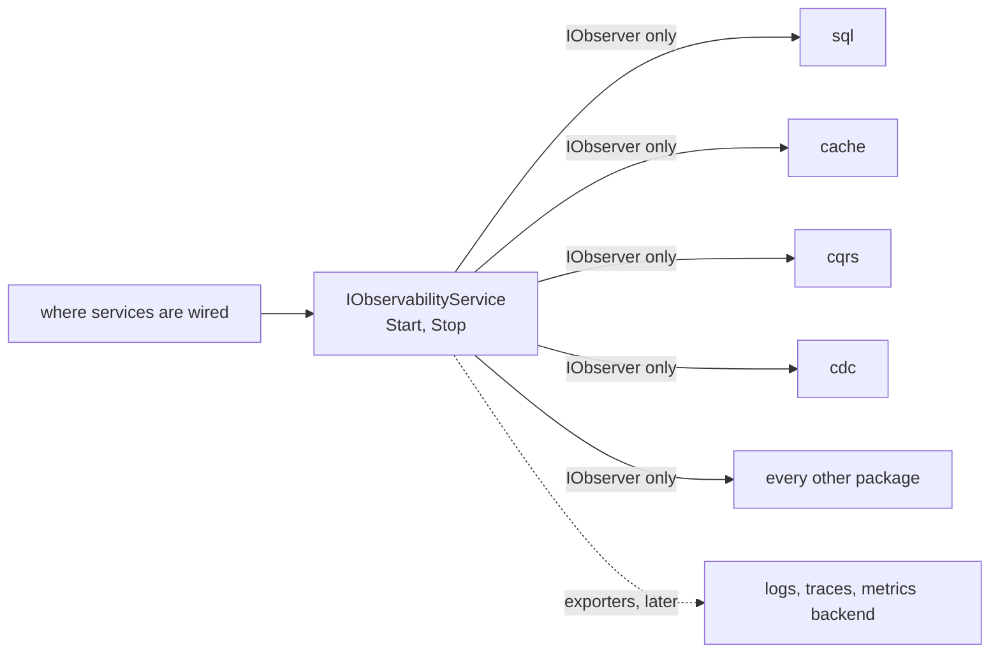
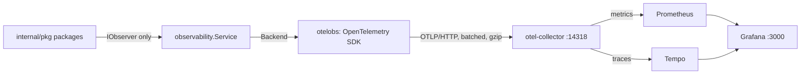

# Observability

What `internal/pkg` measures, and how a package plugs into it.

**Status: every package in `internal/pkg` is instrumented, and the service exports metrics and traces over OTLP.** [observability.types.go](../internal/pkg/observability/observability.types.go) is the contract, and [observability.go](../internal/pkg/observability/observability.go) is an in-memory implementation (`Service`) plus a no-op (`Nop`). The API package is covered by a Hertz middleware, `api.Observe`, which the API service mounts on every route. What is still missing is the wiring site that hands one observer to every service; see [section 6](#6-what-is-not-built-yet).

## Contents

1. [The idea](#1-the-idea)
2. [What a package gets](#2-what-a-package-gets)
3. [Using it in a package](#3-using-it-in-a-package)
4. [What is measured, package by package](#4-what-is-measured-package-by-package)
5. [Rules](#5-rules)
6. [What is not built yet](#6-what-is-not-built-yet)

---

## 1. The idea

Every package takes one optional dependency, an `IObserver`, the way it already takes a cache or a SQL service. It calls the observer and never imports a telemetry library. What sits behind the interface (OpenTelemetry, the in-memory `Service`, nothing) is chosen where the services are wired, so instrumenting a package never changes its imports and never changes what other packages see.

A package given no observer uses `observability.Nop()`, which writes nothing. A struct built as a bare literal (no constructor) is safe too: each package's `begin` helper falls back to `Nop` when its observer is nil.



Logs, traces and metrics answer different questions, and one observer gives all three:

| Signal | Question | Where |
|---|---|---|
| Metrics | What is wrong, how broadly, since when? | `Meter`, and the count and duration of every `Operation` |
| Traces | Where did this operation spend its time? | `Tracer`, and the span of every `Operation` |
| Logs | What happened, with what safe context? | `Logger`, which is a plain `*slog.Logger` |

## 2. What a package gets

All of it is in `internal/pkg/observability`.

| Type | Purpose |
|---|---|
| `IObserver` | What a package is given: `Logger`, `Meter`, `Tracer` and `Begin`, each for a `Component`. Safe for concurrent use. |
| `IObservabilityService` | The observer plus `Start` and `Stop`. Created at wiring time; only the `IObserver` is passed on. |
| `Operation` | One unit of work as a whole: a span, a count and a duration, closed by one `End(err)`. |
| `Meter`, `Counter`, `Gauge`, `Histogram` | For totals the generic operation metrics do not cover. |
| `Tracer`, `Span` | For a package's own spans. |
| `Component` | The bounded set of packages: `sql`, `cache`, `cqrs`, `cdc`, `broker`, `queue`, and the rest. |
| `Outcome` | `success`, `error`, `retry`, `dlq`, `skipped`. Bounded, so safe as a label. |
| `Resource` | Which process is reporting: service name, namespace, version, environment. |

Helpers: `Nop()`, `Pick(...)` (first non-nil observer, else `Nop`), `IsNop`, `New(resource, logger)`. The in-memory `Service` keeps a registry that tests read with `Snapshot()` and `Find(name, attrs)`.

The registry protects itself from what callers pass:

| Limit | Behavior |
|---|---|
| Label values | Cut to `MaxLabelValueLen` (128) bytes on a character boundary; invalid UTF-8 and control characters are removed. |
| Series | At most `MaxSeries` (2000). Past it, new series fold into one `overflow="true"` series per component, so no count is lost, and `Overflowed()` says how many were folded. A non-zero value means a label that should be bounded is not. |
| Outcome | One of the five bounded values. Anything else ends as `error`, so it can neither create a series nor hide a failure. |
| Counter, gauge, histogram values | A negative counter delta, and NaN, infinity or a negative histogram value, are ignored. |
| Nil or zero `Service` | Usable: every method is safe, and a zero `Service` records. A log backend that panics cannot stop `Start` or `Stop`. |

`Attr` is `slog.Attr`, so `slog.String`, `slog.Int` and the rest build attributes for logs, spans and metrics alike.

### The shared instruments

One counter and one histogram cover every operation of every package, told apart by the `component`, `operation` and `outcome` attributes. A new package is observable without defining a metric.

| Instrument | Type | Meaning |
|---|---|---|
| `operations_total` | counter | Operations finished, by component, operation and outcome |
| `operation_duration_seconds` | histogram | How long they took |
| `inflight_operations` | gauge | Operations started and not yet ended |

### The CQRS instruments

`cqrs.Stats` is the one set of totals the code kept before this work, so it has named instruments of its own: `cqrs_batches_total`, `cqrs_records_total`, `cqrs_applied_total`, `cqrs_duplicates_total`, `cqrs_tombstones_total`, `cqrs_skipped_total`, `cqrs_dead_lettered_total`, `cqrs_retries_total`, `cqrs_stale_total`, `cqrs_commit_failures_total`, `cqrs_hooks_total`, `cqrs_hooks_dropped_total`, `cqrs_repaired_total`, the gauge `cqrs_awaiting_rows`, and the histogram `cqrs_batch_duration_seconds`.

## 3. Using it in a package

Each package takes the observer as an option and treats nil as "no telemetry". The shape differs only where the package already had a constructor convention:

| Package | How the observer is given |
|---|---|
| `cache`, `sql`, `cdc`, `broker`, `cron`, `pdf`, `qr`, `security`, `smtp`, `sms`, `otp`, `storage`, `broadcast` | `WithObserver(o)`, a trailing variadic `Option` |
| `auth`, `config` | `WithObserver(o)`; the services are generic, so the `Option` works through a small `observed` interface |
| `queue` | `queue.Observer(o)`, a `ServiceOption` |
| `cqrs`, `pagination` | the exported `Observer` field |
| `api` | `api.Observe(o)`, a Hertz middleware |

Instrumenting an operation is the same in every package:

```go
func (s *Service) Verify(ctx context.Context, key string) (ok bool, err error) {
	if key == "" {
		return false, ErrEmptyKey // refused before any work: not counted
	}
	ctx, op := s.begin(ctx, "verify")
	defer func() { op.End(err) }()
	// ...
}
```

`End(err)` picks `success` for a nil error and `error` otherwise. Where the answer is more specific, say so before `End`:

```go
op.SetOutcome(observability.OutcomeSkipped) // an expected answer: a miss, a wrong password, a duplicate
op.SetOutcome(observability.OutcomeDLQ)     // parked on the dead-letter topic
op.SetOutcome(observability.OutcomeRetry)   // failed, and will be tried again
```

Two conventions hold across the packages:

- **A call refused before any work is not counted.** A nil argument, an empty key, a service that is not started: `begin` runs after those checks, so a flood of bad calls cannot hide the real error rate.
- **An expected answer is `skipped`, not `error`.** A cache miss, a lost `SetNX`, a wrong password, a wrong or expired code, a missing or invalid session token, a duplicate batch, an empty or oversize upload, a URL refused for pointing at a private address. The caller still receives the real error; only the metric changes. This keeps the error rate a measure of faults, while a guessing attack still shows up as its own series.

## 4. What is measured, package by package

Tests for all of this share one package, [tests/internal/obstest](../tests/internal/obstest/obstest.go): `New` (an in-memory observer), `Count` and `Counter` (how often an operation ended with an outcome), `NoLeak` (a secret, key or name must not be in the registry), `NoSeries` (a refused call must not be counted) and `NothingInFlight`. A package's `observer_test.go` is a few lines of setup plus those. The dashboard in [telemetry/ecoop-observability.json](../telemetry/ecoop-observability.json) is checked against the code by `tests/packages/observability/dashboard_test.go`: every metric, label, component, outcome and operation name in its queries must exist, so a rename fails the build instead of leaving a blank panel.

The `operation` names are bounded and fixed.

| Component | Operations | Notes |
|---|---|---|
| `sql` | `start`, `run`, `ping`, `migrate`, `fresh` | |
| `cache` | one per command (`get`, `set`, `setnx`, `delete`, ...) | A `get` miss is `skipped`. Labelled by `cache_family`, never the key. |
| `cqrs` | `handle`, plus the counters above | `handle` is one batch. A fully duplicate batch is `skipped`. `cqrs_awaiting_rows` is reported by the repair loop. |
| `cdc` | `deliver`, `commit`, `dead_letter` | A failed `deliver` that will repeat is `retry`; a parked record is `dlq`. |
| `broker` | `publish`, `handle`, `dead_letter` | As `cdc`. |
| `queue` | `enqueue`, `run` | `run` is one job; `RetryAfter` is `retry`; a job with no handler here is `skipped`. |
| `cron` | `create_job`, `remove_job`, `execute` | Job runs are counted by `queue` as `run`, not here. |
| `pagination` | `paginate`, `count`, `exists` | Labelled by `table`, never the filter values. |
| `api` | one per route template, `unmatched` for no route | 5xx and a panic are `error`; 429 is `retry`; 4xx is `success`. The path is never recorded, only the template. |
| `auth` | `set_session`, `load_session`, `clear_session` | A missing or invalid token is `skipped`. |
| `otp` | `generate`, `verify`, `revoke` | A wrong, expired or exhausted code is `skipped`. |
| `security` | `hash_password`, `verify_password`, `encrypt`, `decrypt`, `encrypt_data`, `decrypt_data` | A wrong password is `skipped`. |
| `smtp`, `sms` | `send`, `deliver` | |
| `pdf` | `ping`, `generate`, `generate_to_s3` | |
| `qr` | `encode`, `decode` | |
| `storage` | `run`, `ping`, `upload`, `fetch_url`, `delete_file`, `presign`, `remove_all` | An empty or oversize upload, and a URL refused for a private address, are `skipped`. Never a file name, key, bucket or URL. |
| `broadcast` | `start`, `ping`, `dispatch` | Never a channel, event or payload. |
| `config` | `load`, `reload`, and `get` on failure only | A successful `Get` writes nothing, because it is read on hot paths. Never a variable name or value. |

Freshness matters as much as counts for replication. `cqrs_awaiting_rows` is the number of parked rows still waiting for repair, and the CDC consumer's event age (now minus the record's timestamp) is the figure that says the read database is behind. The first is reported today; the second is not yet.

## 5. Rules

1. **Bounded labels only.** Only these keys survive on a metric: `component`, `operation`, `outcome`, `topic`, `consumer_group`, `table`, `cache_family`. The registry drops anything else, so a row key, member, account, transaction or request ID, a raw URL or a SQL statement can never become a label. Such values may go in a log or a span, where access and retention are controlled.
2. **Telemetry never decides correctness.** A write must not wait for, or fail because of, a slow or absent telemetry backend. A nil observer must be safe, and `End` must never block.
3. **Never record data.** Error text, log lines, span attributes and dead-letter headers carry the SQLSTATE and location, not row values (`sql.Describe`, `cqrs.safeErr`). The same applies to tokens, cookies, authorization headers, passwords, one-time codes, hashes, file names and keys, channel names, payloads, config values and anything a member or account owns. Each package has a test that fails if such a value reaches the registry.
4. **One log per error.** An error is returned or logged, not both. Log at the top of a unit of work, with a stable message and the variable data as attributes, so a log aggregator groups by message.
5. **Seconds and bytes.** Durations are seconds, sizes are bytes, totals are counters that only go up.
6. **Do not instrument the same thing twice.** If a package wraps its operation in `Begin`, the layer above does not also count it as the same operation. This is why `cron` does not count job runs, and why the `api` middleware does not count the cache or SQL calls a handler makes.

## 6. Exporting, and what is still missing

### How it is wired



`main.go` provides `otelobs.Module`, which reads the environment (`otelobs.Setup`), opens the exporter, starts the service and, on shutdown, flushes it. Packages take an `observability.IObserver` and never import OpenTelemetry: `internal/pkg/observability/otelobs` is the only package that does, and a test fails if another one does.

| Setting | Meaning |
|---|---|
| `APP_NAME`, `APP_VERSION`, `APP_ENV` | `service.name`, `service.version`, `deployment.environment.name` |
| `LOG_LEVEL` | `debug`, `info`, `warn`, `error`; anything else stops startup |
| `OTEL_EXPORTER_OTLP_ENDPOINT` | the collector's base URL; empty exports nothing and the app still works |
| `OTEL_EXPORTER_OTLP_INSECURE` | `http://` is refused unless this is `true` |
| `OTEL_EXPORTER_OTLP_HEADERS` | `k=v,k2=v2`, for a hosted backend's key; never logged |
| `OTEL_TRACES_SAMPLER`, `OTEL_TRACES_SAMPLER_ARG` | for example `parentbased_traceidratio` and `0.1`. Metrics are never sampled |
| `OTEL_METRIC_EXPORT_INTERVAL`, `OTEL_BSP_*`, `OTEL_EXPORTER_OTLP_TIMEOUT` | batching and timeouts |
| `OTEL_SDK_DISABLED` | `true` exports nothing |

A malformed value is an error at startup that names the setting and never prints a credential. The OpenTelemetry SDK itself only logs a bad sampler and then samples everything, which is why the check is here.

Local stack: `docker compose --profile telemetry up -d otel-collector prometheus tempo grafana`. The collector is on host port **14318** (override with `OTEL_COLLECTOR_PORT`), not 4318, because another tracing stack commonly holds 4318. Grafana loads [telemetry/ecoop-observability.json](../telemetry/ecoop-observability.json) and both datasources by itself.

### What it guarantees

- **Telemetry never blocks or fails the app.** Spans go through a batcher with a bounded queue that drops, not blocks; a dead or slow collector costs a counted drop (`Backend.Dropped()`), a log line at most once a minute, and nothing else. Tested with a dead collector, a hung one, one that answers 5xx and then recovers, and a saturated queue.
- **Shutdown is bounded.** `Stop` flushes, but never for longer than `ShutdownTimeout` (10s). A flush that fails is logged and does not fail the application's shutdown.
- **A backend that panics cannot reach a caller.** The in-memory registry keeps counting regardless.
- **Spans carry no secrets.** Attribute names that look like a password, token, cookie, session or key are replaced; values that look like a JWT, a bearer token, an email or a card number are replaced; `db.query.text` has its literals removed (`$1` is kept); structs and errors are recorded by type, never by content; strings are cut at 256 bytes and a span takes at most 64 attributes. An error is an Error status and an `exception.type`, never its text. Metrics only ever carry the bounded label keys.
- **Trace context is not taken from the internet.** `api.Observe` ignores an incoming `traceparent` unless `api.TrustTraceHeaders()` is set, for a hop that is trusted to start a trace (a gateway, another of our services); otherwise a stranger could choose the trace id or force sampling. Baggage is never propagated. `api.ExposeTraceID()` puts the trace id in the response, off by default. `api.SkipRoutes(...)` keeps probes out of the metrics.
- **Trace context crosses Kafka.** `broker.Publish` writes `traceparent`, and the consumer continues that trace, so a message is one trace from publish to handle, and the handler's own context carries it. A record with a missing or hostile header is handled normally as the root of its own trace. Debezium's change events cannot carry a trace (the write-ahead log does not hold one).
- **Logs find their trace.** `observability.Logger(ctx, observer, component)` adds `trace_id` and `span_id` when the context has a span.
- **Probes.** `api.Liveness()` answers 200 and checks nothing. `api.Readiness(observer, timeout, checks...)` answers 503 when a check fails and names which, but never returns the error's text; checks run concurrently under one timeout and a panicking or hung check is only a failure.

### Verified against real services

`tests/packages/observability/otelobs/e2e_test.go` (build tag `integration`, skipped when the stack is not up) runs the app's own `Setup` against the collector, Prometheus, Tempo and Grafana in compose: metrics arrive under the dashboard's names and labels, with histogram buckets; every dashboard query is accepted by the real Prometheus; Grafana provisions the dashboard and both datasources; and a trace is read back from Tempo through Grafana with its parent and child spans, the failed span as an error, and none of the error text.

### What is still missing

- **Logs are not sent over OTLP.** They go to stderr as JSON and carry `trace_id` and `span_id`; a log shipper (Promtail, the Grafana agent) that reads the container output is what puts them in Loki. There is no Loki in the compose stack.
- **No gRPC or HTTP-client propagation.** Only the API's request and response headers and Kafka record headers are covered; the repository has no gRPC code.
- **No tail sampling.** Sampling is by trace id at the source. Keeping every error and slow trace needs the collector's tail-sampling processor, which is not configured.
- **Go runtime, host and connection-pool metrics are not exported.** The shared operation metrics are; `runtime` and pool gauges are not wired.
- **No alert rules.** The dashboard exists; thresholds and routing do not.
- **The other panels of `docker/grafana/ecoop-dashboard.json`** read metric names (`http_server_request_duration_seconds`, `db_client_*`) that this code does not produce, so they stay empty. The new dashboard in `telemetry/` is the one that matches.
- **The API has no authentication yet.** The `api` package builds the server, applies the security middleware and the observer to every route, and starts and stops under fx. Authenticating callers and checking tenants is route middleware that does not exist yet (see [api.md](api.md)).
- **Nothing outside `internal/pkg`.** Frontends, desktop and mobile apps, Rust services, PgBouncer, Citus, Debezium JMX metrics, Kafka broker metrics and CI metrics are out of scope until they exist in this repository.
