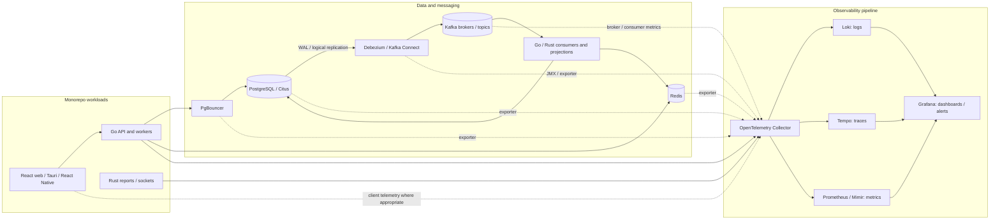

# Horizon / E-Coop Monorepo Observability Standard

> **Purpose:** Make every important request, background job, database operation, CDC event, Kafka message, cache action, security event, and deployment measurable and traceable across the monorepo.
>
> **Scope:** React + TypeScript frontends, Tauri desktop, React Native, Go services, Rust report-generation/socket services, PostgreSQL, PgBouncer, Citus, Redis, Kafka, Debezium/Kafka Connect, and the telemetry platform.

## 1. Executive summary

Use **OpenTelemetry (OTel) as the instrumentation standard** and the **Grafana LGTM stack** as the initial observability platform:

- **Loki** stores searchable logs.
- **Tempo** stores distributed traces.
- **Prometheus locally / Mimir in production** stores time-series metrics.
- **Grafana** provides dashboards, alerting, and incident investigation.
- **OpenTelemetry Collector** receives, filters, enriches, batches, and exports telemetry.

Treat the monorepo as one distributed system, not as a collection of unrelated services. Each deployable process must have its own stable service identity, while trace context and safe correlation identifiers connect work across HTTP, SQL, Redis, Kafka, workers, and CDC consumers.

**Important status distinction:** the existing observability notes describe a working Go/OpenTelemetry baseline with logs, traces, metrics, a Grafana dashboard, and instrumentation for several clients. They do **not** establish that Debezium JMX metrics, all Kafka broker metrics, all frontend/Rust instrumentation, production alert rules, durable Collector queues, or every dashboard described below are already implemented. Those are requirements to verify or build, not claims about the current deployment.

## 2. Existing baseline and target coverage

| Area | Existing baseline from the current project notes | Target / verification needed |
|---|---|---|
| Go services | OpenTelemetry SDK, structured Zap/OTel logs, trace and metric export, Go runtime/host metrics | Standardize all services and versions; verify exporter health, semantic attributes, sampling, SLOs, and alerts |
| HTTP | Hertz instrumentation is documented for one server/client stack; the supplied Horizon API uses Echo and custom Telescope tracing | Ensure Echo middleware records every request once, route templates are used, errors/status are consistent, and trace context propagates |
| SQL/PostgreSQL | Bun DB instrumentation, query spans with placeholders, writer/reader pool metrics are documented | Add PostgreSQL server metrics, PgBouncer metrics, Citus metrics, lock/query visibility, and replication-slot/WAL monitoring |
| Redis | Redis client spans and pool/timeouts are documented | Add server exporter metrics, cache hit/miss/eviction/latency dashboards, and cache freshness/invalidation measurements |
| Kafka application | Broker helper documents publish/consume traces, Sarama metrics, counts, processing duration, retries, and DLQ behavior | Verify trace headers across producers/consumers; add broker, consumer-lag, partition, Connect, and DLQ dashboards/alerts |
| Debezium / Kafka Connect | Not confirmed by the supplied implementation notes | Enable protected JMX metrics; monitor connector/task state, source progress, snapshots, errors, replication slots, retained WAL, and event age end-to-end |
| Rust report/socket service | Rust is part of the described architecture; full instrumentation is not confirmed | Add OTel spans, service metrics, job-stage timing, queue depth, socket health, and runtime/process metrics |
| React / Tauri / React Native | Complete client-side instrumentation is not confirmed | Add privacy-safe client errors, startup/navigation/network measurements, release tags, and trace propagation where supported |
| Security | Security middleware and structured request logging exist in the Go API code | Add actionable security-event metrics and alerts; redact secrets; separate operational logs from immutable financial audit records |
| Telemetry pipeline | Local `grafana/otel-lgtm` setup and OTLP ports 4317/4318 are documented | Protect endpoints, monitor Collector queues/drops, use durable queueing for critical remote exports, and alert on telemetry gaps |
| CI/CD and monorepo | GitHub and Nx are part of the architecture | Add build/test/deploy metrics, release markers, dependency scan results, and service-version correlation |

## 3. Target architecture

### Important deployment notes

1. The **Collector is the telemetry gateway**, not a substitute for instrumenting applications or exporters. Use application instrumentation for request/business context and exporters for server-side database, broker, cache, and runtime health.
2. Do not expose Grafana, Prometheus, Collector debug endpoints, JMX, PostgreSQL exporters, Redis exporters, or Kafka management endpoints publicly. Restrict them to private networks and authenticated operators.
3. Use TLS and authenticated OTLP for traffic crossing trust boundaries. Keep local unauthenticated OTLP endpoints bound to loopback or a private container network.
4. Use separate credentials and least-privilege read-only monitoring roles for exporters. An exporter must not need ledger-write privileges.
5. Keep telemetry storage, retention, and access controls separate from application databases and financial audit storage.

## 4. Observability principles

### 4.1 Three signals, one investigation path

- **Metrics** answer: *What is wrong, how broadly, and since when?*
- **Traces** answer: *Where did this operation spend time, and which dependency failed?*
- **Logs** answer: *What happened, with what safe context and error details?*

Every request/job/message should carry trace context wherever the protocol supports it. Log records emitted inside a span should contain `trace_id` and `span_id`. A metric alert should link to a dashboard, and the dashboard should make it easy to move to related traces/logs.

### 4.2 Resource attributes

Use a consistent, low-cardinality resource schema across Go, Rust, and JavaScript services:

| Attribute | Requirement | Example |
|---|---|---|
| `service.name` | Required; stable per deployable service | `ecoop-server`, `report-worker`, `cdc-consumer` |
| `service.namespace` | Required; groups the product/system | `e-coop` |
| `service.version` | Required; release/build version | SemVer or immutable build version |
| `deployment.environment.name` | Required | `development`, `staging`, `production` |
| `service.instance.id` | Optional; unique running instance | Runtime-generated instance identifier |
| `cloud.region` / deployment region | When applicable | Actual hosting region |
| `vcs.revision` | Prefer for release correlation | Git commit SHA |
| `telemetry.sdk.language` | Standard SDK attribute where supported | `go`, `rust`, `nodejs` |

Do not put request IDs, account IDs, member IDs, email addresses, phone numbers, transaction IDs, raw URLs, or arbitrary SQL into metric labels. They create high cardinality and can expose sensitive data. Put safe correlation IDs in logs/traces only when access and retention policies permit it.

### 4.3 Consistent naming

- Follow OpenTelemetry semantic conventions for HTTP, database, messaging, and runtime instrumentation.
- Use route templates such as `/members/:id`, not a concrete path containing a real identifier.
- Use bounded values for dimensions: `outcome=success|error|retry|dlq`, `operation=insert|update|delete`, and known service/connector/topic names.
- Use seconds for durations, bytes for sizes, and monotonic counters for totals.
- Treat names in this document marked **logical metric** as the required meaning. Map them to the actual instrumentation/exporter names in your environment; do not assume the metric exists until verified in Prometheus.

## 5. Minimum service-level signals

Every API, worker, consumer, and scheduled job should expose the following where applicable.

| Signal | What to measure | Why it matters |
|---|---|---|
| Availability | Successful probes, request success, dependency readiness | Detects outages and partial failure |
| Traffic | Requests, jobs, messages, and business operations per second | Establishes load and makes drops visible |
| Errors | Error count/rate by bounded error type and outcome | Identifies broken paths and regressions |
| Duration | p50, p95, p99 latency and operation duration | Shows tail latency hidden by averages |
| Saturation | CPU, memory, goroutines/threads, pool usage, queues, file descriptors | Finds capacity bottlenecks before failure |
| Freshness | Age of the newest/oldest unprocessed data or projection | Detects stale member/account views and delayed CDC |
| Correctness | Reconciliation differences, duplicate handling, invariant failures | Detects financial correctness issues that uptime metrics cannot catch |

### 5.1 API (Echo / HTTP)

Measure request count, latency histogram, in-flight requests, response classes, timeout count, panic/recovery count, request-body rejections, rate-limit denials, and dependency time per route template. Include method, normalized route, status, service version, and trace IDs in controlled logs/traces.

**Verify in the current Horizon API:** ensure every request creates one server span; avoid duplicate spans where Telescope and middleware overlap; capture status/error consistently; and apply security headers before the response is committed. Do not record raw payloads in panic logs. Do not use client-supplied `X-Forwarded-For` or other forwarding headers as trusted identity unless the reverse-proxy trust chain is configured correctly.

### 5.2 Go services and workers

Use the existing runtime metrics and extend them with:

- Goroutine count, heap/in-use memory, allocation rate, GC pause duration, CPU, process uptime, and process restarts.
- Worker count, queue depth/age, active jobs, job duration, retries, cancellations, timeouts, and outcome.
- Per-job business counters with bounded dimensions, such as `ledger_posting` outcome or `report_generation` outcome.
- Graceful-shutdown duration, jobs aborted at shutdown, and telemetry flush failures.

### 5.3 Rust report generation and socket services

Use the same OTel resource naming and W3C trace context as the Go services. Instrument each significant report stage rather than timing only the whole job.

Measure:

- Report requests, queue wait, total duration, query duration, render/serialization duration, output bytes, timeout/failure count, cancellation, and retry count.
- Socket connections, handshake failures, active connections, reconnects, send duration, pending/outbound queue depth, dropped messages, and publish failures.
- CPU/memory, process restarts, and worker saturation.

Never log report content, access tokens, session secrets, or exported financial rows.

### 5.4 Frontend: React, Tauri, and React Native

Where platform support and privacy policy permit, measure:

- App startup/cold-start time, uncaught exceptions, handled API failures, navigation/screen-load duration, request latency, WebSocket connection/reconnect outcomes, and release version.
- Client-to-server trace propagation for supported HTTP calls, using the standard `traceparent` header.
- A safe release marker so a spike can be compared to the deployed version.

Do not collect form values, page contents, authorization headers, tokens, member/account information, or unrestricted URL query strings. Do not attach a member/user ID to metric labels. Apply consent, sampling, and retention rules appropriate to the product. Native/browser traces should be sampled so they do not overwhelm the backend.

## 6. CDC observability: PostgreSQL → Debezium → Kafka → consumers

CDC is a critical data path and needs **separate source, connector, broker, consumer, and end-to-end freshness measurements**. A green connector status by itself does not prove that changes have reached and been applied to downstream systems.

### 6.1 Pipeline stages and required measurements

| Stage | Required signals | Failure patterns to detect |
|---|---|---|
| PostgreSQL source | Write-ahead log generation rate, replication slot active state, retained WAL bytes/segments, slot restart/confirmed-flush positions, database disk capacity | Connector outage causes WAL retention or disk exhaustion; slot becomes inactive/invalidated; source stops advancing |
| Debezium connector | Connector/task state, restart count, task errors, last source event time, last emitted event time, snapshot state/progress, captured records, poll/batch duration, queue capacity/use, source lag | Connector task failed, snapshot stuck, source is healthy but no events are emitted, growing source lag |
| Kafka Connect | Worker availability, task rebalances/restarts, rebalance duration, request failures, connector configuration errors, JVM heap/GC, producer errors | Worker churn, failed tasks, memory pressure, unable to publish records |
| Kafka broker/topic | Broker availability, offline/under-replicated partitions, ISR changes, request latency/errors, bytes in/out, disk usage, partition skew, produce failures | Topic unavailable, replication degradation, disk pressure, partition bottleneck |
| Consumer group | Lag by topic/partition/group, lag growth rate, age of oldest available event, records consumed, processing duration, commit failures, retry count, rebalance count | Consumers are alive but falling behind, poison message, commits failing, repeated rebalances |
| DLQ/retry | Retry volume, DLQ messages by source topic/reason class, oldest DLQ age, redrive success/failure | Silent permanent data loss, unbounded retry loop, unowned failed records |
| Downstream write/projection | Apply duration, rows/events applied, transaction failures, duplicate/idempotency hits, projection freshness, reconciliation failures | Data is consumed but not committed, duplicate side effects, stale account/member views |
| End-to-end freshness | Source commit/event timestamp to successful downstream apply timestamp, measured by event age distribution | The pipeline appears healthy at each component while users still see stale data |

### 6.2 Debezium and Kafka Connect instrumentation

- Enable and scrape the **JMX metrics that Debezium, Kafka Connect, and Kafka actually expose for the deployed versions**. Debezium provides connector-specific metrics in addition to Kafka/Connect JMX metrics; use the metric names and MBeans documented for the exact connector version.
- Export those metrics through a maintained JMX-to-Prometheus exporter or an approved Collector pipeline. Keep JMX private and authenticated where supported; do not expose JMX ports to the public network.
- Track connector/task state as a numeric metric or explicit health signal, and alert on a failed task even when the Kafka broker is healthy.
- Monitor snapshots separately from steady-state streaming. A snapshot may intentionally take a long time; alert based on the expected snapshot window, progress, and no-progress duration rather than a single generic threshold.
- For PostgreSQL, alert on replication-slot inactivity and retained WAL growth well before disk capacity becomes critical. A slot can retain WAL while Debezium is down, which can create storage pressure.
- Keep connector names, topic names, and known table names as bounded dimensions only when the set is controlled. Do not label by event IDs, SQL values, member IDs, or account IDs.

### 6.3 Logical CDC metric contract

Implement or map the following **logical metrics**; names may vary by exporter:

| Logical metric | Type | Meaning |
|---|---|---|
| `cdc_connector_up` | Gauge | Connector/task is healthy and running |
| `cdc_connector_restarts_total` | Counter | Connector/task restarts |
| `cdc_records_captured_total` | Counter | Change records emitted, by bounded operation type |
| `cdc_source_lag_seconds` | Gauge/histogram | Source change age at connector capture time |
| `cdc_snapshot_in_progress` | Gauge | Whether an initial/recovery snapshot is running |
| `cdc_snapshot_records_total` | Counter | Snapshot records processed |
| `cdc_replication_slot_wal_bytes` | Gauge | WAL retained for a slot |
| `kafka_consumer_lag_records` | Gauge | Outstanding records for a group/topic/partition |
| `cdc_oldest_unprocessed_event_age_seconds` | Gauge | Age of the oldest event not successfully applied downstream |
| `cdc_event_processing_duration_seconds` | Histogram | Consumer handler/apply duration |
| `cdc_events_applied_total` | Counter | Successful downstream application |
| `cdc_duplicate_events_total` | Counter | Duplicates safely ignored by idempotency guard |
| `cdc_dlq_messages_total` | Counter | Messages routed to a dead-letter topic |
| `cdc_reconciliation_mismatches_total` | Counter | Detected data correctness discrepancies |

Keep labels bounded: `connector`, `topic`, `consumer_group`, `operation`, `outcome`, and controlled `table` values. Do not add `event_id`, transaction ID, row primary key, or organization/member ID labels.

### 6.4 Measure freshness, not only offset lag

Record time checkpoints at the stages you control: source change/transaction time when available, connector emission, consumer receive, and successful downstream commit. Publish a histogram or summary for end-to-end delay and a gauge for the oldest outstanding event age.

**Caveats:** timestamps must be comparable; monitor clock synchronization for database, connector, brokers, and consumers. A source timestamp field and a connector processing timestamp represent different stages. Consumer offset lag measures backlog, not elapsed time, and a low record lag may still hide a single very old stuck event.

### 6.5 Preserve causality through asynchronous processing

- Propagate W3C `traceparent`/`tracestate` in Kafka headers for application-produced messages and extract them in consumers.
- For CDC events originating from ordinary database writes, do **not** assume the SQL trace automatically crosses the WAL and Debezium boundary. The database log stream does not inherently contain the application's active trace context.
- Where business-level causality is required, use an outbox/event envelope or explicit safe correlation fields such as `event_id`, `correlation_id`, and `causation_id`; connect source and consumer spans through trace links or searchable log fields.
- Keep these IDs in event/log/trace context when policy permits; never use them as Prometheus labels.
- Use stable event IDs, idempotent consumers, transactional application where feasible, and replay-safe side effects. Debezium/Kafka delivery may be at-least-once; duplicate handling must be designed and measured.

### 6.6 CDC incident questions the dashboard must answer

1. Is the source database generating changes?
2. Is the replication slot active, and how much WAL is retained?
3. Is the Debezium connector/task running, and when did it last emit a change?
4. Is Kafka accepting and retaining records with adequate replication?
5. Which consumer group/partition is behind, and is lag growing?
6. What is the age of the oldest unprocessed event?
7. Are consumers failing, retrying, or sending records to the DLQ?
8. Is downstream data being committed successfully and remaining consistent?
9. Is the delay caused by source capture, Kafka, consumer capacity, SQL locks, or cache/projection work?

## 7. Kafka observability

Use both **client instrumentation** and **broker/exporter metrics**. Application publish/consume spans are not sufficient to observe partition replication, disk pressure, group coordination, or lag.

### Producer signals

- Publish count and bytes, publish duration, error rate, timeout count, retry count, batch size, compression ratio where available, and metadata/connection errors.
- Per-message trace context and a safe event/correlation identifier for investigation.
- Separate intentional application retries from broker/client retry behavior.

### Consumer signals

- Records/bytes consumed, processing duration, processing failures, commit failures, retries, rebalances, records in flight, and queue depth/age.
- Consumer group lag **and its rate of change** by controlled topic/group/partition dimensions.
- DLQ count and oldest DLQ age, plus a documented replay procedure and owner.
- Handler success should mean the required business transaction has committed—not merely that a message was read.

### Broker and topic signals

- Broker/controller availability, offline partitions, under-replicated partitions, ISR shrink/expand, produce/fetch request latency and errors, network/request queue saturation, disk capacity, bytes in/out, and partition skew.
- Topic retention/compaction configuration, replication factor, minimum in-sync replicas, and capacity must be checked against data durability requirements.
- Treat lag thresholds as service objectives, not a universal fixed number; a ledger/projection topic may have a different acceptable delay from a notification topic.

## 8. SQL, PostgreSQL, PgBouncer, and Citus

Instrument at two layers: **application query spans/pool stats** and **database/server-side metrics**. Application spans show what a request waited for; server metrics show contention and capacity across all clients.

### 8.1 PostgreSQL

Monitor:

- Connection count by state, active/idle-in-transaction sessions, transaction age, query duration, lock waits, deadlocks, statement failures, commits/rollbacks, temporary files, cache hit rates, database size, table/index growth, vacuum/analyze health, replication health, WAL generation, checkpoints, I/O, and disk space.
- Use `pg_stat_activity`, `pg_stat_database`, `pg_stat_replication`, replication-slot statistics, and `pg_stat_statements` where available and approved.
- Use normalized query fingerprints and parameterized queries for diagnostics; do not export literal bind values or full SQL containing sensitive data.
- Maintain a separate view for application workload versus CDC/replication roles where possible.
- Watch transaction duration and lock waits for ledger mutations. Long-running transactions can delay vacuum, retain WAL, block other writes, and increase CDC lag.

### 8.2 PgBouncer and client pools

For each writer/reader pool, track pool open/idle/in-use/maximum connections, wait count, wait duration, timeouts, connection creation failures, and saturation. For PgBouncer, track client/server connections, waiting clients, pool saturation, query/wait time, and server connection limits.

**Alert on sustained pool wait or saturation before connection exhaustion.** Increasing pool size without checking PostgreSQL capacity may move the bottleneck to the database rather than solve it.

### 8.3 Citus

Where Citus is enabled, monitor coordinator/worker availability, distributed query latency, worker connection saturation, shard distribution/skew, shard rebalancing, metadata synchronization, distributed transaction failures, and node/worker disk pressure. Break down metrics by bounded cluster/worker/operation names; do not label with tenant or account identifiers.

## 9. Redis and cache correctness

Application spans and server metrics should distinguish **cache latency**, **cache availability**, and **cache effectiveness**.

Measure:

- Command duration/errors/timeouts, pool usage and connection wait, commands/sec, operations by bounded command class, used memory, fragmentation, evictions, expirations, rejected connections, blocked clients, replication health where applicable, and Redis server latency events.
- Application cache hit/miss counts and hit ratio by a bounded cache family/purpose such as `member_profile`, `permissions`, or `reference_data`; never label metrics with actual keys.
- Cache invalidation events, invalidation failures, stale-read detection where measurable, and age since the last successful refresh.
- If Redis is used for rate limiting, track allow/deny results, cache/store failures, and whether failure behavior is fail-open or fail-closed.

For ledger and balance-related data, define which values are authoritative in PostgreSQL and which are derived/cacheable. Track cache/projection freshness, and never treat a cache hit as proof of ledger correctness. Use explicit invalidation/versioning or a bounded TTL strategy; monitor invalidation lag and reconciliation exceptions.

## 10. Ledger and financial correctness observability

Operational telemetry can show that a service is healthy while the data is wrong. Add dedicated **business correctness signals** with no sensitive payloads.

Measure:

- Ledger posting attempts, successful posts, validation rejects, idempotency replays, duplicate-command conflicts, reversals, approval outcomes, and transaction rollbacks.
- Double-entry invariant violations, unbalanced journal attempts, negative/invalid state transitions, sequence/gap anomalies where relevant, and reconciliation mismatches.
- Time from accepted command to durable posting; time from durable posting to downstream projection/cache visibility.
- Reconciliation job duration, rows scanned/checked, mismatches found, backlog, last successful run, and last verified watermark.
- Audit export failures, administrative adjustments, manual overrides, and unusual bulk activity.

**Rules:**

1. Emit counters/timers and safe reason codes, not balances, full journal lines, member information, or payment/account identifiers.
2. Ledger writes must remain transactionally correct even if the telemetry backend is unavailable. Observability must never be in the transaction's correctness path.
3. Use database transactions, uniqueness/idempotency guarantees, and explicit reversal/correction entries; do not silently overwrite posted ledger history.
4. Keep business audit trails separate from ordinary application logs and traces. Financial audit records need their own access controls, retention, integrity protection, and review process.
5. Alert immediately on confirmed double-entry invariant failures or reconciliation mismatches above the accepted tolerance (for ledger values, the intended tolerance is normally zero at the smallest currency unit, subject to the product's accounting rules).

## 11. Security observability

Security signals should be actionable and structured. They must not become a second store of secrets or personal data.

### Events to measure and alert on

- Authentication success/failure and suspicious failure bursts, MFA failures, token/session validation failures, and account lockouts.
- Authorization denials and repeated access to resources outside a principal's scope.
- Rate-limit denials, suspicious path detection, host/CORS rejection, invalid payload/body-limit rejection, and malformed request patterns.
- WAF blocks/challenges, mTLS handshake failures, certificate expiry/rotation status, and service-to-service identity failures.
- Secret/configuration load failures, unexpected privilege changes, database permission denials, audit/logging pipeline failures, and suspicious admin actions.
- Bulk data exports, sensitive report generation, ledger reversals/manual adjustments, and unusual permission changes.

### Safe security-event fields

Record event timestamp, service, environment, event type, result/reason code, request/trace ID, source IP only where justified and protected, actor reference only when approved, normalized route/resource type, and deployment version. Apply redaction and access restrictions to security logs.

**Never log** access tokens, refresh tokens, cookies, authorization headers, passwords, private keys, full request/response bodies, raw session IDs, full member profiles, bank/payment credentials, or unrestricted SQL parameters. Sanitize untrusted strings to prevent log injection. Do not expose internal error text to clients merely because it was recorded in telemetry.

### Security telemetry checks for the current API

- The supplied code's panic-recovery path can attach a captured request payload to logs. For financial/member endpoints, replace this with explicit redaction or omit payloads entirely.
- The origin allowlist contains production, staging, development, localhost, and plain-HTTP entries. Split configuration by environment and remove development/HTTP origins from production.
- The suspicious-path tracker is useful, but monitor its own cache failures, tracking failures, volume, and false-positive rate. Background logging/metrics failures must not crash request handling.
- Security headers and request logs should be verified by integration tests because middleware order and response-commit timing can affect whether headers/status are observed correctly.
- Do not interpret CORS as authentication or authorization. Sensitive routes still require identity and per-resource authorization checks.

## 12. Logs: structure, correlation, and redaction

Use JSON logs in production with stable field names and a shared schema across Go and Rust.

| Field | Purpose |
|---|---|
| `timestamp` | Event time in UTC |
| `severity_text` | `debug`, `info`, `warn`, `error` |
| `service.name`, `service.version`, `deployment.environment.name` | Find the source and release |
| `trace_id`, `span_id` | Jump between Loki and Tempo |
| `event.name` / `event.category` | Stable event taxonomy |
| `http.request.method`, `http.route`, `http.response.status_code` | HTTP diagnosis without raw identifier paths |
| `duration_ms` or standard duration fields | Latency diagnosis |
| `error.type`, `error.code` | Searchable error classification without leaking secrets |
| `request_id` / `correlation_id` | Safe cross-service investigation where policy permits |

Use error types/reason codes that are bounded and documented. Do not create one log event per every successful low-level operation at high traffic; use metrics for rates and traces for sampled detail. Avoid duplicate request logs from multiple middleware layers; one canonical access log is preferred, with additional component logs only when they add meaningful context.

## 13. Distributed tracing standards

### Span structure

A typical synchronous path should look like:

`HTTP server request → application/business operation → SQL/Redis/client spans → response`

A typical asynchronous path should look like:

`producer/business operation → Kafka produce → consumer receive/process → SQL transaction/cache update`

CDC needs a distinct model because PostgreSQL WAL capture is asynchronous. Connect the source business action to a CDC consumer with trace context in an outbox event or safe correlation fields, or use span links when a parent-child relationship is not accurate.

### Span attributes

Use semantic conventions and bounded attributes: service, operation, normalized route, DB system/namespace/table where permitted, DB role, messaging system/destination/operation, outcome, retry count, and safe error type.

Avoid capturing raw SQL values, full payloads, secrets, personal data, or ledger details. Configure SQL instrumentation to use parameter placeholders and sanitized query summaries. Review all automatic instrumentation defaults before enabling it in production.

### Sampling

- Development: a higher sampling rate is acceptable for debugging.
- Production: select a sampling strategy based on volume, cost, and incident needs. Parent-based sampling can preserve distributed trace consistency; consider Collector tail sampling if retaining errors and slow traces is a requirement.
- Keep high-value security/ledger audit events in the appropriate log/audit system; do not rely on sampled traces as an audit record.
- Monitor dropped spans and sampling rates, and record the active policy with deployment configuration.

## 14. OpenTelemetry Collector and telemetry-pipeline health

The observability system must monitor itself. Missing telemetry is a production incident because it removes the ability to diagnose other incidents.

Track:

- Receiver accepted/refused telemetry, processor errors, exporter send failures, retry counts, queue size/capacity, dropped logs/spans/metrics, memory-limiter activity, batch sizes, Collector CPU/memory, and scrape-target health.
- Collector and backend availability, ingestion delays, Loki/Tempo/Mimir capacity, retention pressure, and failed dashboard/alert evaluations.
- Telemetry volume by service/environment and sudden changes in event rate that might indicate a service outage or duplicate instrumentation.

For exporters sending telemetry over networks, configure retry and sending queues; use persistent queue storage/WAL for hops where telemetry loss is unacceptable and test recovery. Set memory limits and queue sizes from measured throughput and available resources. Ensure telemetry cannot exhaust application or Collector memory.

**Failure behavior:** application requests and ledger commits should not fail just because Loki, Tempo, Mimir, or the Collector is temporarily unavailable. Telemetry loss/fallback should be visible through self-monitoring and stderr/platform logs.

## 15. Dashboards required in Grafana

Create the following dashboards as code, review them in pull requests, and version them with the monorepo.

### 15.1 Executive / Service Overview

- Request/job/message throughput, error rate, p50/p95/p99 latency, saturation, availability, active incidents, and release version.
- Service map or links into HTTP, dependency, Kafka, CDC, security, and ledger dashboards.
- Environment and service filters using controlled labels.

### 15.2 HTTP / API

- Requests/sec by normalized route and status class.
- p50/p95/p99 duration, 4xx/5xx rate, in-flight requests, timeout/panic counts, rate-limit denials, and request size-limit rejections.
- Slowest routes by aggregate duration and traces for exemplars where available.

### 15.3 SQL / PostgreSQL / PgBouncer / Citus

- Query latency/error rate by normalized operation/table and DB role.
- Active sessions, lock waiters, deadlocks, transaction age, pool utilization/waits, PgBouncer waiting clients, connection capacity, disk/WAL, replication, vacuum, and Citus worker/shard health.
- Link slow-query fingerprints to safe database traces.

### 15.4 Redis / Cache

- Operation latency/errors/timeouts, connections/pool wait, cache hit ratio, eviction, memory, blocked clients, Redis server latency events, and invalidation/freshness delay.

### 15.5 Kafka / Consumers

- Broker health, offline/under-replicated partitions, request latency, disk/network, consumer lag and growth, processing duration, retries, commits, rebalances, and DLQ counts/age.

### 15.6 CDC Pipeline

- One stage-by-stage view: PostgreSQL slot/WAL → Debezium connector/task/snapshot → Kafka topic/partition → consumer group → SQL/projection/cache apply.
- Most important panels: connector/task state, time since last emitted event, source lag, retained WAL bytes, consumer lag, oldest unprocessed event age, DLQ age/count, downstream apply failures, and reconciliation results.
- Annotate snapshot starts, connector restarts, schema changes, deploys, replay runs, and maintenance windows.

### 15.7 Security / Audit Signals

- Authentication failures, authorization denials, rate-limiting, suspicious paths, WAF blocks, invalid host/CORS, mTLS failures/certificate expiry, admin actions, and security-telemetry pipeline health.
- Restrict dashboard and log access to the appropriate roles; do not put personal data on broad-access dashboards.

### 15.8 Ledger Correctness

- Posting outcomes, idempotency replays, reversal rate, durable-posting latency, projection freshness, reconciliation duration/status, and invariant violations.
- Any mismatch drilldown should lead to an access-controlled audit workflow, not expose account or member data in a public dashboard.

### 15.9 Frontend / Mobile / Desktop and CI/CD

- App startup/crash/error rates, API failures and latency, WebSocket reconnects, release version, build/test/deploy duration, Nx cache hit ratio, test failures, deployment frequency, rollback count, and security scan findings.

## 16. Alerting policy

Alert on **user/business symptoms first**, and use component alerts to diagnose the cause. Every alert must have an owner, severity, runbook, useful dashboard link, and a clear next action. Avoid paging for transient noise that no one can act on.

### Severity levels

- **SEV-1 / Critical:** financial correctness violation, confirmed ledger invariant failure, material unauthorized activity, sustained production write unavailability, or imminent risk of database/disk exhaustion. Page immediately.
- **SEV-2 / High:** core service unavailable/degraded, CDC freshness beyond its approved objective, sustained high error rate, failed critical connector/task, or DLQ accumulation affecting financial projections. Page the on-call engineer.
- **SEV-3 / Warning:** rising pool wait/consumer lag, repeated non-critical retries, cache degradation, certificate expiry approaching, or telemetry export degradation that has not yet caused a complete blind spot. Ticket/notify the owning team.
- **Informational:** deployments, scaling, snapshot/replay progress, planned maintenance, and recovery milestones.

### Initial alert catalogue

Thresholds below are **starting points to tune against the product's SLOs and measured baseline**, not universal guarantees.

| Alert | Trigger concept | Priority | First investigation |
|---|---|---|---|
| API availability/error budget burn | Success ratio below the SLO or 5xx ratio elevated over a sustained window | SEV-1/2 | API Overview → release markers → failing route traces |
| API latency regression | p95/p99 exceeds the route objective for a sustained period | SEV-2/3 | Trace waterfall → SQL/pool/Redis dependencies |
| Database connection pressure | Pool waits/timeouts or PostgreSQL/PgBouncer capacity nearing safe limit | SEV-2/3 | Pool dashboard → active/idle-in-transaction sessions → slow queries |
| Long transaction / lock storm | Transaction or lock wait exceeds the workload's agreed limit | SEV-2 | PostgreSQL activity/locks → application trace owner |
| Replication slot/WAL risk | Retained WAL grows beyond budget or approaches available disk headroom | SEV-1/2 | Slot activity → Debezium task state → disk capacity |
| Debezium connector/task failed | Any required production connector/task remains failed beyond its recovery window | SEV-2 | Connect logs/JMX → recent config/schema/deploy changes |
| CDC freshness breach | Oldest unprocessed event age exceeds the pipeline objective | SEV-1/2 for financial projections | Stage-by-stage CDC dashboard; source vs capture vs broker vs consumer |
| Kafka replication degradation | Offline partitions or sustained under-replicated partitions | SEV-1/2 | Broker/partition health → disk/network/controller events |
| Consumer lag is growing | Lag and oldest-event age grow for several windows without sufficient drain rate | SEV-2/3 | Consumer processing duration/errors/rebalances → SQL saturation |
| DLQ accumulation | New DLQ messages for critical topics or DLQ age/volume exceeds policy | SEV-2/3 | Failure reason class → replay eligibility/runbook |
| Ledger invariant/reconciliation failure | Any confirmed unbalanced ledger or unauthorized correction; mismatch beyond accepted tolerance | SEV-1 | Stop unsafe downstream action if applicable → protected audit/reconciliation workflow |
| Cache freshness issue | Invalidation/refresh delay exceeds the endpoint's consistency requirement | SEV-2/3 | Consumer offsets → invalidation failures → database source of truth |
| Security attack pattern | Sustained auth failures, access denials, suspicious path bursts, WAF/mTLS anomaly | SEV-2/3; SEV-1 if compromise indicated | Security dashboard → protected event records → incident response |
| Telemetry pipeline dropping data | Export queue fills, export failures persist, or critical targets disappear | SEV-2/3 | Collector self-metrics → backend status/capacity → network/auth |
| Monitoring blind spot | A required production target is absent or has stopped reporting | SEV-2 | Target inventory → deployment/collector/scrape config |

For numeric threshold design, use burn-rate alerts for SLOs where appropriate and alert on trends/symptoms over meaningful windows. Avoid paging on a single brief latency spike or a single consumer-lag sample without checking whether it is growing or violates the business freshness objective.

## 17. SLOs and service objectives

Define an SLO for each user-facing API and each asynchronous pipeline. Do not set all components to one latency objective.

| Service / flow | SLI to define | Notes |
|---|---|---|
| Public/API request | Successful eligible requests / total eligible requests; latency percentile within objective | Exclude intentional business rejections from availability errors, but count unexpected 5xx/timeouts |
| Ledger posting | Durable successful posting rate and latency; correctness invariants | Correctness is not traded for availability; failed telemetry export must not affect posting |
| CDC pipeline | Source-to-apply event freshness; successful apply rate; oldest unprocessed event age | Set a product-approved freshness objective per topic/table criticality |
| Read projection/cache | Projection/cache age and read correctness within defined contract | Make authoritative-source and staleness semantics explicit |
| Report generation | Successful completion and duration by report class/size class | Avoid labels based on customer or report IDs |
| Telemetry pipeline | Telemetry delivery health and acceptable loss window | Monitor the monitoring platform itself |

Measure a baseline before committing to SLO targets. Publish SLOs with an owner, calculation, window, exclusions, and an escalation policy.

## 18. Monorepo and CI/CD observability

The monorepo's build/deployment system is part of production reliability.

Measure and publish:

- Nx task/build/test duration, cache hit/miss ratio, affected-project scope, flaky test count, failure rate, queue/wait time, and CI runner saturation.
- Deployment duration, failed deployment rate, rollback count, commit-to-production lead time, and time from deploy to first error/latency regression.
- Dependency/security scan findings by severity and age, coverage/trend of static analysis, and time to remediate critical findings.
- Runtime `service.version` and deployment annotations mapped to a Git commit SHA. Prefer annotations/resource attributes over adding commit SHA as a metric label to every time series.

Use the same service catalog names in Nx project configuration, deployment metadata, OTel resources, dashboards, and runbooks. Require observability changes (metric definitions, dashboard panels, alert rules, and runbook updates) in the same pull request as major new services or pipelines.

## 19. Access control, privacy, retention, and cost

- Apply least-privilege roles to Grafana folders, Loki queries, Tempo traces, and audit/security views.
- Enforce authentication and TLS on remote telemetry endpoints. Keep JMX and exporter endpoints private.
- Set retention separately for operational logs, traces, metrics, security events, and financial audit records based on legal, contractual, incident-response, and storage requirements.
- Redact credentials and sensitive attributes at the application and Collector layers. Collector filtering is defense in depth, not permission to log sensitive payloads in the first place.
- Set per-service sampling and log-level policies; avoid debug-level payload-like events in production.
- Monitor storage growth, ingestion volume, cardinality, and query cost. Control metric dimensions before ingestion; do not solve cardinality only by increasing backend resources.
- Test that secrets and sample financial/member values cannot be found in Loki, Tempo, browser telemetry, CI artifacts, or exception reports.

## 20. Operational runbook requirements

Every production alert/runbook should contain:

1. **Impact:** what users/data flow can be affected.
2. **Signals:** which metric/log/trace/dashboards confirmed the symptom.
3. **First checks:** a short ordered diagnostic path.
4. **Safe actions:** restart, replay, failover, rollback, or scaling actions and their risks.
5. **Data correctness:** whether messages/transactions can be replayed safely and how duplicates are prevented.
6. **Escalation:** service owner, data owner, security contact, and incident commander as applicable.
7. **Recovery verification:** confirm SLO recovery, CDC freshness catch-up, DLQ handling, reconciliation success, and absence of new correctness violations.

For CDC replay, connector restarts, snapshot re-runs, cache rebuilds, and ledger recovery, document idempotency and whether an action can repeat external side effects. Do not make manual offset changes or delete replication slots as a first-line fix without a reviewed recovery plan.

## 21. Implementation roadmap

### Phase 1 — Instrumentation and safe defaults

- [ ] Inventory every deployable Nx project, Go service, Rust process, frontend app, worker, topic, connector, database, and cache.
- [ ] Ensure all services share the OTel resource schema and supported trace propagation.
- [ ] Normalize HTTP route names and eliminate duplicate request instrumentation/logging.
- [ ] Remove raw payload logging and verify secret/PII redaction.
- [ ] Verify production OTLP authentication/TLS, environment-specific CORS/origin config, and private exporter/JMX endpoints.
- [ ] Publish one baseline service overview dashboard and confirm every service is visible.

### Phase 2 — Dependencies and CDC

- [ ] Enable PostgreSQL, PgBouncer, Citus, Redis, Kafka broker/client, and Kafka Connect/Debezium metrics.
- [ ] Add consumer lag, source lag, slot/WAL retention, connector/task state, DLQ, and downstream-apply metrics.
- [ ] Add event timestamps and safe correlation IDs so source-to-apply freshness can be measured.
- [ ] Verify trace propagation for application Kafka events and explicit correlation/linking for CDC-originated events.
- [ ] Create SQL/cache/Kafka/CDC dashboards and runbooks.

### Phase 3 — Correctness and security

- [ ] Add ledger posting/idempotency/reversal/reconciliation metrics and invariant alerts.
- [ ] Add authentication/authorization/rate-limit/WAF/mTLS/admin-action security signals.
- [ ] Restrict audit and security dashboards; validate access logs and retention settings.
- [ ] Perform replay, duplicate-message, connector-outage, database-saturation, and cache-staleness exercises.

### Phase 4 — SLOs, resilience, and release correlation

- [ ] Agree on API SLOs and per-pipeline CDC freshness objectives with product/data owners.
- [ ] Add symptom-based alerts, SLO burn-rate alerts, and tested notification routing.
- [ ] Configure and test Collector retry queues/persistent storage where warranted; alert on queue saturation and telemetry drops.
- [ ] Add deployment annotations, service versions, and Nx/CI metrics.
- [ ] Run failure drills: Collector outage, Loki/Tempo/Mimir outage, Kafka broker/consumer failure, Debezium failure, replication-slot WAL growth, Redis outage, and PostgreSQL pool exhaustion.
- [ ] Review alert usefulness and remove alerts that do not lead to an action.

## 22. Definition of done

Observability for a production service or data pipeline is **not complete** until:

- [ ] It has a stable service identity and environment/version metadata.
- [ ] Request/job/message throughput, errors, latency, and saturation are measurable.
- [ ] Logs are structured, redacted, and correlated with traces where appropriate.
- [ ] Its database/cache/message dependencies can be identified in traces and dashboards.
- [ ] It has an owner, dashboard, actionable alerts, and a runbook.
- [ ] Telemetry pipeline health is monitored and access-controlled.
- [ ] Metric labels are bounded and contain no customer/member/account/transaction IDs.
- [ ] Asynchronous work has observable retries, idempotency outcomes, DLQ behavior, and freshness.
- [ ] Financial flows have separate correctness/reconciliation signals and protected audit records.
- [ ] Failure/recovery behavior has been tested rather than assumed.

## 23. Useful local workflow

The existing project notes describe a local LGTM stack exposed through Grafana at `http://localhost:3000`, with OTLP gRPC on `localhost:4317` and OTLP HTTP on `localhost:4318`. Confirm the actual Docker Compose ports, credentials, service names, and dashboard provisioning in the repository before relying on these in scripts or team onboarding.

Recommended workflow:

1. Start the local dependencies and observability stack using the repository's Docker Compose setup.
2. Run the target service with a unique `service.name`, the correct environment, and OTLP pointed at the local Collector/LGTM endpoint.
3. Generate an API request, SQL operation, Redis operation, Kafka publish/consume, and a CDC update using safe test data.
4. Verify the expected metric changes, trace spans, structured logs, trace/log correlation, and error behavior in Grafana.
5. Stop or misconfigure a dependency in a local environment and confirm that dashboards/alerts identify the failure without exposing sensitive values.
6. Restore the dependency and verify recovery, queue drain, CDC freshness catch-up, and no duplicate financial side effects.

Do not use production member/account data for local telemetry tests.

## 24. Authoritative references

- [OpenTelemetry semantic conventions](https://opentelemetry.io/docs/specs/semconv/) — common attribute and signal naming.
- [OpenTelemetry database semantic conventions](https://opentelemetry.io/docs/specs/semconv/db/database-spans/) — database span conventions and query sanitization guidance.
- [OpenTelemetry database metrics](https://opentelemetry.io/docs/specs/semconv/db/database-metrics/) — database metric definitions.
- [OpenTelemetry Collector resiliency](https://opentelemetry.io/docs/collector/resiliency/) — sending queues, retries, persistent storage, and monitoring exporter queue health.
- [Debezium monitoring](https://debezium.io/documentation/reference/stable/operations/monitoring.html) — connector-specific and Kafka Connect JMX metrics.
- [Debezium PostgreSQL connector](https://debezium.io/documentation/reference/stable/connectors/postgresql.html) — logical decoding and replication-slot/WAL considerations.
- [PostgreSQL monitoring statistics](https://www.postgresql.org/docs/current/monitoring-stats.html) — activity, replication, database, and slot statistics.
- [Redis latency monitoring](https://redis.io/docs/latest/operate/oss_and_stack/management/optimization/latency-monitor/) — diagnosing latency spikes.
- [Prometheus alerting practices](https://prometheus.io/docs/practices/alerting/) — symptom-oriented, actionable alerts.
- [OWASP Logging Cheat Sheet](https://cheatsheetseries.owasp.org/cheatsheets/Logging_Cheat_Sheet.html) — security event logging, data minimization, and safe log handling.

---

**Ownership:** Assign an owner for each service and each critical data pipeline. Review this document whenever a new service, datastore, Kafka topic, CDC connector, security boundary, or production deployment path is introduced.